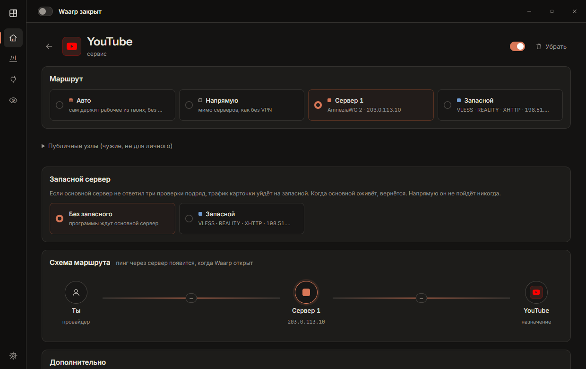
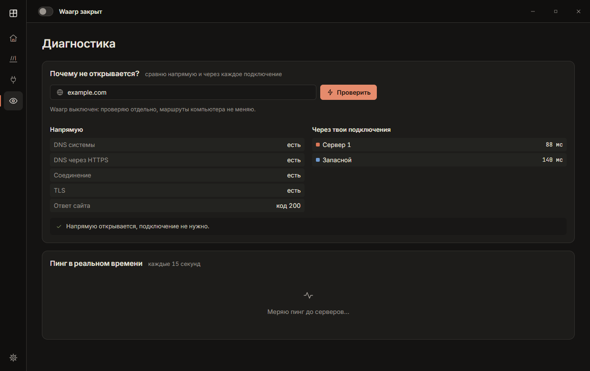

<p align="center">
  
</p>

<p align="center">
  <a href="README.md"><b>English</b></a> · <a href="README.ru.md">Русский</a>
</p>

<p align="center">
  
  
  
  
</p>

<p align="center">
  <strong>One place to route apps, sites and services through the connection you choose.</strong><br>
  Personal VPNs, proxies, groups, failover and an opt-in public catalog — without a paid Waarp subscription.
</p>

<p align="center">
  <a href="#download"><b>Download</b></a> ·
  <a href="#screenshots">Screenshots</a> ·
  <a href="#why-waarp">Features</a> ·
  <a href="docs/README.md">Documentation</a> ·
  <a href="README.ru.md">Русский</a> ·
  <a href="ROADMAP.md">Roadmap</a>
</p>

> [!IMPORTANT]
> **Current source is a release candidate, not an approved stable build.** The existing Windows download is an older beta; Android has no publicly published production-signed APK yet. [Versions, checksums and release criteria](docs/RELEASES.md).

<p align="center">
  
</p>
<p align="center"><sub>Windows desktop capture from the repository. UI details may differ from the latest RC source.</sub></p>

## Why Waarp

| **Precise routing** | **Stable path selection** | **Useful diagnostics** |
| :--- | :--- | :--- |
| Assign a direct or protected path to apps, services, domains and custom targets. | Auto holds a working personal route; explicit failover avoids reflexive ping-based switching. | Compare Direct and protected connections with DNS, TCP, TLS and HTTP observations. |
| **Bring your own connections** | **Public pool, by choice** | **Desktop + mobile** |
| WireGuard / AmneziaWG, VLESS, VMess, Trojan, Shadowsocks, Hysteria2, TUIC, OpenVPN and supported imports. | Explicitly load, inspect and choose third-party nodes. Public relays are not silently promoted into Auto. | Electron-based Windows client and native Kotlin / Compose Android client in one repository. |

No multi-path aggregation, no guaranteed latency improvement, and no anonymity promise. [How routing works](#how-it-works) · [Public node trust and sources](docs/SOURCES.md).

## Download

|  |  |
| :--- | :--- |
| **[Download v0.4.0 portable EXE](../../releases/download/v0.4.0/Waarp-0.4.0-portable.exe)** · [Release notes](../../releases/tag/v0.4.0) | **Android 0.5.0-rc.4** is in source. [Build/install instructions](docs/ANDROID.md#build-and-install) · [Android CI](../../actions/workflows/android.yml) |
| Published beta, Windows 10/11 x64. The newer **0.4.1-rc.2** desktop source has not been published as a verified binary. | Debug APKs can be installed for testing after a successful build. **Unsigned release APKs are not installable**; production signing and acceptance remain separate. |

**[All releases](../../releases)** · **[Preview publishing workflow](.github/workflows/release-preview.yml)** · **[Release and integrity guide](docs/RELEASES.md)**

The repo is currently private; GitHub download and Actions links may require repository access. Third-party infrastructure can cost money, even though Waarp itself has no subscription.


## How it works

Waarp does not put the whole computer behind one VPN. Each target gets its own intent:

- **Direct** — the normal network;
- **a specific connection** — one of your own VPN / proxy profiles, or a group of them;
- **Auto** — picks from your own eligible connections and stays on a working one.

Targets can be applications, services or custom hosts. A whole-computer mode routes everything else through a chosen path while explicit rules still apply.

### Auto

Auto is built to be predictable, not to re-optimise every few seconds:

- only your own non-public connections take part;
- a healthy path stays in use while it has active connections; one missed probe does not switch it;
- switching for better performance happens only when the current path has no active connections and repeated checks show a clear improvement; confirmed failure can trigger failover;
- probing is bounded, and the engine keeps at most **16** Auto connections live at once, so a library of hundreds of profiles does not hold hundreds of tunnels in memory (the others stay in your library and remain usable manually and in diagnostics);
- Auto never falls back to Direct or to a public node. With no eligible path, the route stays unavailable instead of leaking.

Failover closes the affected sessions so traffic can use the replacement path. Games and other apps may need to reconnect.

### Diagnostics

Waarp answers practical questions: does the target work directly? Through one of my connections? Did it fail at DNS, TCP, TLS or HTTP? It avoids overclaiming: "fails on Direct but works through a connection" is evidence, not automatically censorship. With the tunnel closed, a separate local checker probes a bounded set of your connections without creating a TUN or touching system routes.

Displayed latency measures an HTTP check, not game-server ping. Waarp selects a path for each route; it does not send a session through several paths at once (multipath).

### Supported connections

Engine: [sing-box-lx](https://github.com/Leadaxe/sing-box-lx) (bundled, with its license, under `engine/`).

- AmneziaWG / WireGuard
- VLESS, VMess, Trojan, Shadowsocks
- Hysteria2, TUIC v5
- OpenVPN (scripts, plugins and external credential files are rejected)
- subscriptions with supported share links, including JSON / YAML containers containing those links

Import from file, clipboard, QR code, subscription link, local discovery or manual entry. Subscription refresh is manual. JSON / YAML import extracts supported share links; it does not convert arbitrary native client configurations.

The public connection catalog refreshes and checks its nodes only when you request it, with no startup or periodic catalog probes. It is a separate, low-trust source; public nodes never join Auto silently. Those nodes are run by third parties, not Waarp; their operators may log traffic that is not end-to-end encrypted. Sources: [docs/SOURCES.md](docs/SOURCES.md).

## Screenshots

<table>
<tr><td align="center" width="50%"><br><sub><strong>Routing</strong> — assign an app to a path</sub></td><td align="center" width="50%"><br><sub><strong>Connections</strong> — import or add your own</sub></td></tr>
<tr><td align="center"><br><sub><strong>Diagnostics</strong> — compare connectivity observations</sub></td><td align="center"><br><sub><strong>Overview</strong> — see where traffic goes</sub></td></tr>
</table>

These are the existing Windows captures. No verified, sanitized Android device screenshots are committed yet; we intentionally do not substitute mockups for real captures. See [screenshot guidelines](docs/screenshots/README.md).

## Conservative Windows failure handling

Waarp is designed to avoid leaving network state behind and to refuse a start when the state is ambiguous:

- before every start it checks, read-only, for a leftover Waarp adapter or a taken service subnet, and refuses to start rather than change anything;
- stopping tries a verified CTRL_BREAK only when an isolated console is available; otherwise it terminates only its own child through the retained handle, then verifies exit;
- it never deletes network adapters, resets Winsock or DNS, or touches another VPN;
- after sleep it restarts at most once, and only when a usable network is back.

Coverage includes offline regressions, native Windows process checks and production-renderer checks. Native TUN lifecycle and protocol tests have separate evidence and boundaries. Physical sleep, shutdown, full routing, other-VPN coexistence and the private remote endpoint require the [stable acceptance matrix](docs/STABLE-AUDIT-2026-11-16.md). Actual results are in [the validation record](docs/VALIDATION-2026-11-16.md); the failure contract is in [docs/RELIABILITY.md](docs/RELIABILITY.md).

## Security model

- Electron sandbox, context isolation, no Node integration in the UI.
- VPN secrets are stored with Windows DPAPI; there is no plain-text fallback.
- The bundled engine and its DLL are checked against expected hashes before every start.
- Imported configs are validated before they reach the engine.
- Missing or revoked routes stay blocked instead of becoming Direct.
- A small local bridge lets companion desktop apps request routing for their own target with a per-run token; it never exposes configs or keys. See [docs/BRIDGE.md](docs/BRIDGE.md).

Waarp is a routing tool, not an anonymity guarantee: a connection provider can still see traffic that passes through it.

**DNS protection while running; no independent kill switch.** The tunnel uses temporary Windows DNS filtering (`strict_route`) to limit DNS requests outside the tunnel. This filter depends on the running engine. Waarp does not enforce a separate persistent firewall kill switch; if the engine crashes, Windows may send traffic over its normal route. Do not treat Waarp as leak-proof.

Security issues: please follow [SECURITY.md](SECURITY.md) instead of opening a public issue.

## Build from source

Windows 10/11, Node.js. Administrator rights are needed only when the tunnel starts.

```bash
npm ci
npm run dev
```

Checks (all offline):

```bash
npm run typecheck
npm test
npm run check
npm run build
npm run test:performance
```

`npm run test:ui` serves the built production renderer for Playwright automatically (install Chromium first with `npx playwright install chromium`).

`npm run test:live -- --disposable-windows` creates a real temporary TUN on an administrator Windows test machine and verifies cleanup across 50 cycles. It intentionally disables automatic routes and DNS capture. Run it only on a disposable test machine; it does not establish remote connectivity or full-system routing. The opt-in real-connection runner and AWG library harness are documented in [the validation record](docs/VALIDATION-2026-11-16.md).

## Contributing

See [CONTRIBUTING.md](CONTRIBUTING.md).

Bug reports, routing edge cases and Windows-specific failures are useful even when you do not have a fix. Please remove keys, subscription URLs, tokens, private server addresses and other secrets before posting logs or screenshots.

## Credits

- [sing-box-lx](https://github.com/Leadaxe/sing-box-lx), based on [sing-box](https://github.com/SagerNet/sing-box) — networking engine, shipped as a separate executable; license: see [`engine/LICENSE`](engine/LICENSE), provenance: [`engine/SOURCE.md`](engine/SOURCE.md)
- [Electron](https://www.electronjs.org/), [React](https://react.dev/), [Vite](https://vitejs.dev/)
- [Instrument Sans](https://github.com/Instrument/instrument-sans), [Inter](https://rsms.me/inter/), [JetBrains Mono](https://www.jetbrains.com/lp/mono/) — SIL Open Font License
- [Simple Icons](https://simpleicons.org/) — CC0

Full list: [THIRD_PARTY_NOTICES.md](THIRD_PARTY_NOTICES.md).

ExitLag is a trademark of its respective owner. Waarp is an independent project and is not affiliated with ExitLag.

## License

Waarp's own code is licensed under the [Apache License 2.0](LICENSE), see also [NOTICE](NOTICE).
Bundled third-party components keep their own licenses: the sing-box-lx engine ships as a separate program under its own license (GPL-3.0-or-later text plus an upstream naming/association condition, see [`engine/LICENSE`](engine/LICENSE)), see [THIRD_PARTY_NOTICES.md](THIRD_PARTY_NOTICES.md). Engine binaries are not stored in Git: `npm run engine:fetch` downloads and verifies the pinned release, `npm run dist` refuses to package without them.
