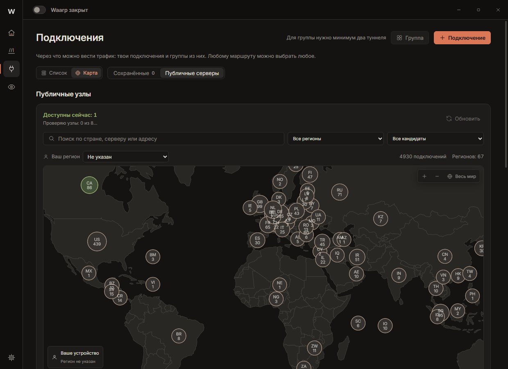

<strong>Windows 10/11 x64 · Android 10+ · 1.0.0</strong> 
English · <a href="README.ru.md">Русский</a> · <a href="https://github.com/INNVoices/waarp/releases">Downloads</a> · <a href="docs/README.md">Documentation</a>

# Choose a connection for each app

Route a browser through a personal VPN, send a domain through another connection and keep other traffic direct. Both clients support saved profiles, groups and an optional catalog of third-party public nodes. Automatic selection uses eligible profiles from your library.

| Windows | Android |
| --- | --- |
| Assign routes to processes, services and domains. Inspect the active path, traffic counters and connection diagnostics. | Set per-app and domain rules, import profiles and change routes from the native Kotlin client. |
| [Desktop routing](docs/SERVER-SELECTION-2026-11-18.md) · [Diagnostics and maps](docs/CONNECTION-TOOLS.md) | [Android guide](docs/ANDROID.md) · [Build and signing](docs/ANDROID.md#build-and-install) |

## Build on a Windows PC

| Command | Output |
| --- | --- |
| `build.bat 1` | Unpacked desktop client in `dist/win-unpacked/` |
| `build.bat 2` | Versioned portable EXE in `dist/` |
| `build.bat apk` | Verified debug APKs for ARM64, ARM32 and x86_64 in `out/android/` |

Use Node.js 22. Android also needs JDK 17 and Python 3. Its native engine is in the checkout. The first Android build downloads the SDK platform and build tools (about 125 MB), Gradle and Maven dependencies. Later builds reuse the local cache. See the [component map and acceptance record](docs/V1.md).

## Install and verify

Choose the asset for your platform in [GitHub Releases](https://github.com/INNVoices/waarp/releases) and compare its SHA-256 with the release checksum list. Debug APKs install as `local.waarp.android.debug`. Updating the production app requires the original signing identity. Published preview files retain their original version numbers. [Release history](docs/RELEASES.md).

Windows needs elevation to start the tunnel. The client checks its engine at startup and protects stored secrets with DPAPI. Android uses the system VPN permission and Android Keystore. Public nodes belong to third parties. If the Windows engine exits, the system may resume its normal network route. [Reliability](docs/RELIABILITY.md) · [Public node sources](docs/SOURCES.md) · [Security reports](SECURITY.md).

## Project

[Contributing](CONTRIBUTING.md) · [Support](SUPPORT.md) · [Roadmap](ROADMAP.md) · [Screenshots](docs/screenshots/README.md) · [Third-party credits](THIRD_PARTY_NOTICES.md)

Desktop application code uses [Apache-2.0](LICENSE). Android application code uses [GPL-3.0-or-later](android/LICENSE). Engine and dependency notices ship with each client.
