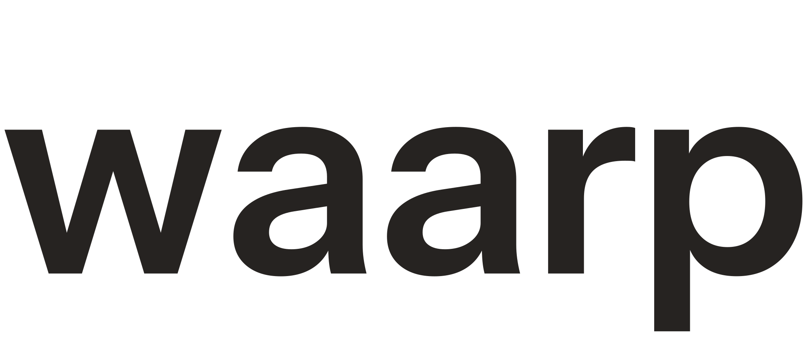
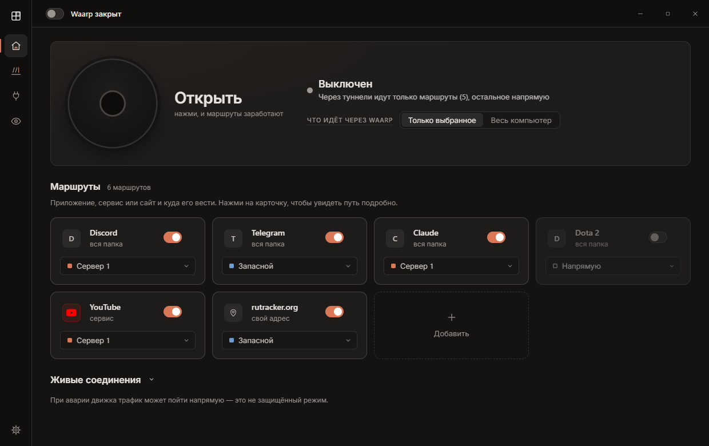

<p align="center">
  <picture>
    <source media="(prefers-color-scheme: dark)" srcset="docs/brand/waarp-wordmark-light.svg">
    <source media="(prefers-color-scheme: light)" srcset="docs/brand/waarp-wordmark-dark.svg">
    
  </picture>
</p>

<p align="center">
  <strong>Open-source Windows traffic routing for apps, sites and unstable networks.</strong><br>
  ExitLag-style routing, but free, transparent and built around your own VPN/proxy paths.
</p>

<p align="center">
  <a href="README.md">English</a> · <a href="README.ru.md">Русский</a>
</p>

<p align="center">
  <a href="#download">Download</a> · <a href="#screenshots">Screenshots</a> · <a href="#how-it-works">How it works</a> · <a href="#security-model">Security</a> · <a href="ROADMAP.md">Roadmap</a> · <a href="#contributing">Contribute</a>
</p>

> **Free and open source. No Waarp subscription required.**
> Bring your own VPN / VPS / proxy paths; third-party infrastructure may have its own cost.

<p align="center">
  
</p>
<p align="center"><em>Route only what needs a different path. Leave the rest of Windows alone.</em></p>

| Route precisely | Stay stable | See what failed |
| --- | --- | --- |
| Apps and sites can use different paths. | Auto holds a working route instead of chasing every ping. | Compare DNS / TCP / TLS / HTTP evidence across Direct and your own paths. |

## Download

**[Download the latest Windows release →](../../releases/latest)**

Windows 10 / 11, x64. The interface is currently Russian-first.

The current source is **0.4.1-rc.1**, a validation candidate. Stable approval is pending the [release acceptance gates](docs/STABLE-AUDIT-2026-11-16.md); CI artifacts are candidate builds, not a claim that every real-network scenario has passed.

### Android APK

The same repository now includes a native Kotlin/Compose Android client, **0.5.0-rc.1**, under `android/`.
Build with `npm run android:build`; verified per-ABI APKs are written to **`out/android/`**. Android 10 (API 29) or later is required.
The client uses Android `VpnService` and a pinned sing-box-lx Android AAR. App routing uses Android package names.
See [Android features, architecture, build and validation](docs/ANDROID.md) for platform differences and signing instructions.
Android approval includes optimized-release UI journeys and a two-hour encrypted AWG2 soak. Signed release APKs use a retained update identity; explicitly unsigned APKs are signing inputs, and debug APKs are separate test builds. See [the build and release acceptance contract](docs/ANDROID.md).

**Found a bug?** Open an issue. **Know how to fix it?** Send a pull request — small, focused fixes are very welcome.

## How it works

Waarp does not put the whole computer behind one VPN. Each target gets its own intent:

- **Direct** — the normal network;
- **a specific connection** — one of your own VPN / proxy profiles, or a group of them;
- **Auto** — picks from your own eligible connections and stays on a working one.

Targets can be applications, services or custom hosts. A whole-computer mode routes everything else through a chosen path while explicit rules still apply.

### Auto

Auto is built to be predictable, not to re-optimise every few seconds:

- only your own non-public connections take part;
- a healthy path stays in use while it has active connections; one missed probe does not switch it;
- switching for better performance happens only when the current path has no active connections and repeated checks show a clear improvement; confirmed failure can trigger failover;
- probing is bounded, and the engine keeps at most **16** Auto connections live at once, so a library of hundreds of profiles does not hold hundreds of tunnels in memory (the others stay in your library and remain usable manually and in diagnostics);
- Auto never falls back to Direct or to a public node. With no eligible path, the route stays unavailable instead of leaking.

Failover closes the affected sessions so traffic can use the replacement path. Games and other apps may need to reconnect.

### Diagnostics

Waarp answers practical questions: does the target work directly? Through one of my connections? Did it fail at DNS, TCP, TLS or HTTP? It avoids overclaiming: "fails on Direct but works through a connection" is evidence, not automatically censorship. With the tunnel closed, a separate local checker probes a bounded set of your connections without creating a TUN or touching system routes.

Displayed latency measures an HTTP check, not game-server ping. Waarp selects a path for each route; it does not send a session through several paths at once (multipath).

### Supported connections

Engine: [sing-box-lx](https://github.com/Leadaxe/sing-box-lx) (bundled, with its license, under `engine/`).

- AmneziaWG / WireGuard
- VLESS, VMess, Trojan, Shadowsocks
- Hysteria2, TUIC v5
- OpenVPN (scripts, plugins and external credential files are rejected)
- subscriptions with supported share links, including JSON / YAML containers containing those links

Import from file, clipboard, QR code, subscription link, local discovery or manual entry. Subscription refresh is manual. JSON / YAML import extracts supported share links; it does not convert arbitrary native client configurations.

The public connection catalog refreshes and checks its nodes only when you request it, with no startup or periodic catalog probes. It is a separate, low-trust source; public nodes never join Auto silently. Those nodes are run by third parties, not Waarp; their operators may log traffic that is not end-to-end encrypted. Sources: [docs/SOURCES.md](docs/SOURCES.md).

## Screenshots

<p align="center">
  
  
</p>
<p align="center">
  
</p>

## Conservative Windows failure handling

Waarp is designed to avoid leaving network state behind and to refuse a start when the state is ambiguous:

- before every start it checks, read-only, for a leftover Waarp adapter or a taken service subnet, and refuses to start rather than change anything;
- stopping tries a verified CTRL_BREAK only when an isolated console is available; otherwise it terminates only its own child through the retained handle, then verifies exit;
- it never deletes network adapters, resets Winsock or DNS, or touches another VPN;
- after sleep it restarts at most once, and only when a usable network is back.

Coverage includes offline regressions, native Windows process checks and production-renderer checks. Native TUN lifecycle and protocol tests have separate evidence and boundaries. Physical sleep, shutdown, full routing, other-VPN coexistence and the private remote endpoint require the [stable acceptance matrix](docs/STABLE-AUDIT-2026-11-16.md). Actual results are in [the validation record](docs/VALIDATION-2026-11-16.md); the failure contract is in [docs/RELIABILITY.md](docs/RELIABILITY.md).

## Security model

- Electron sandbox, context isolation, no Node integration in the UI.
- VPN secrets are stored with Windows DPAPI; there is no plain-text fallback.
- The bundled engine and its DLL are checked against expected hashes before every start.
- Imported configs are validated before they reach the engine.
- Missing or revoked routes stay blocked instead of becoming Direct.
- A small local bridge lets companion desktop apps request routing for their own target with a per-run token; it never exposes configs or keys. See [docs/BRIDGE.md](docs/BRIDGE.md).

Waarp is a routing tool, not an anonymity guarantee: a connection provider can still see traffic that passes through it.

**DNS protection while running; no independent kill switch.** The tunnel uses temporary Windows DNS filtering (`strict_route`) to limit DNS requests outside the tunnel. This filter depends on the running engine. Waarp does not enforce a separate persistent firewall kill switch; if the engine crashes, Windows may send traffic over its normal route. Do not treat Waarp as leak-proof.

Security issues: please follow [SECURITY.md](SECURITY.md) instead of opening a public issue.

## Build from source

Windows 10/11, Node.js. Administrator rights are needed only when the tunnel starts.

```bash
npm ci
npm run dev
```

Checks (all offline):

```bash
npm run typecheck
npm test
npm run check
npm run build
npm run test:performance
```

`npm run test:ui` serves the built production renderer for Playwright automatically (install Chromium first with `npx playwright install chromium`).

`npm run test:live -- --disposable-windows` creates a real temporary TUN on an administrator Windows test machine and verifies cleanup across 50 cycles. It intentionally disables automatic routes and DNS capture. Run it only on a disposable test machine; it does not establish remote connectivity or full-system routing. The opt-in real-connection runner and AWG library harness are documented in [the validation record](docs/VALIDATION-2026-11-16.md).

## Contributing

See [CONTRIBUTING.md](CONTRIBUTING.md).

Bug reports, routing edge cases and Windows-specific failures are useful even when you do not have a fix. Please remove keys, subscription URLs, tokens, private server addresses and other secrets before posting logs or screenshots.

## Credits

- [sing-box-lx](https://github.com/Leadaxe/sing-box-lx), based on [sing-box](https://github.com/SagerNet/sing-box) — networking engine, shipped as a separate executable; license: see [`engine/LICENSE`](engine/LICENSE), provenance: [`engine/SOURCE.md`](engine/SOURCE.md)
- [Electron](https://www.electronjs.org/), [React](https://react.dev/), [Vite](https://vitejs.dev/)
- [Instrument Sans](https://github.com/Instrument/instrument-sans), [Inter](https://rsms.me/inter/), [JetBrains Mono](https://www.jetbrains.com/lp/mono/) — SIL Open Font License
- [Simple Icons](https://simpleicons.org/) — CC0

Full list: [THIRD_PARTY_NOTICES.md](THIRD_PARTY_NOTICES.md).

ExitLag is a trademark of its respective owner. Waarp is an independent project and is not affiliated with ExitLag.

## License

Waarp's own code is licensed under the [Apache License 2.0](LICENSE), see also [NOTICE](NOTICE).
Bundled third-party components keep their own licenses: the sing-box-lx engine ships as a separate program under its own license (GPL-3.0-or-later text plus an upstream naming/association condition, see [`engine/LICENSE`](engine/LICENSE)), see [THIRD_PARTY_NOTICES.md](THIRD_PARTY_NOTICES.md). Engine binaries are not stored in Git: `npm run engine:fetch` downloads and verifies the pinned release, `npm run dist` refuses to package without them.
