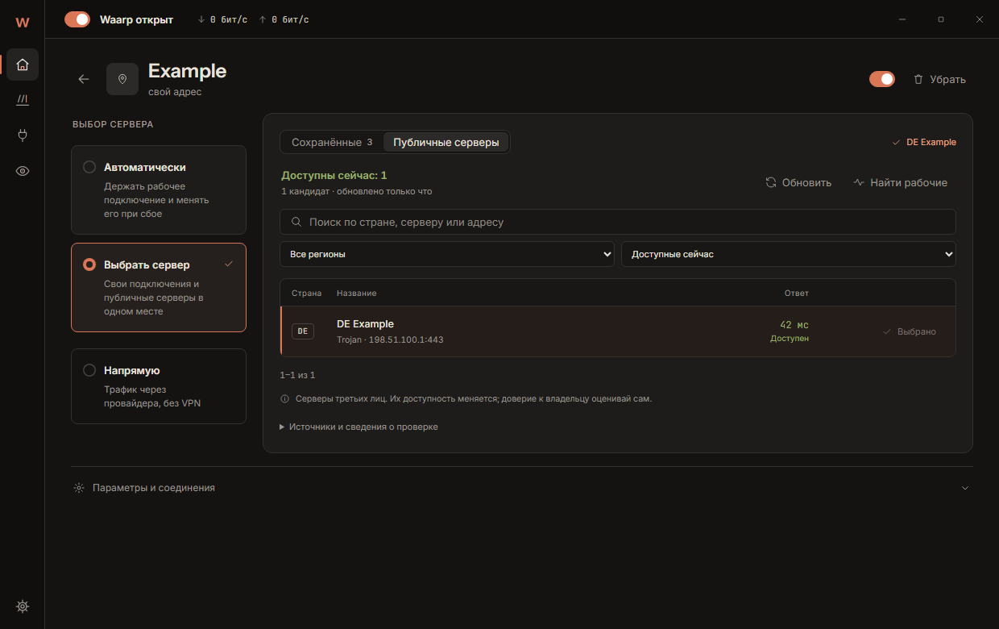
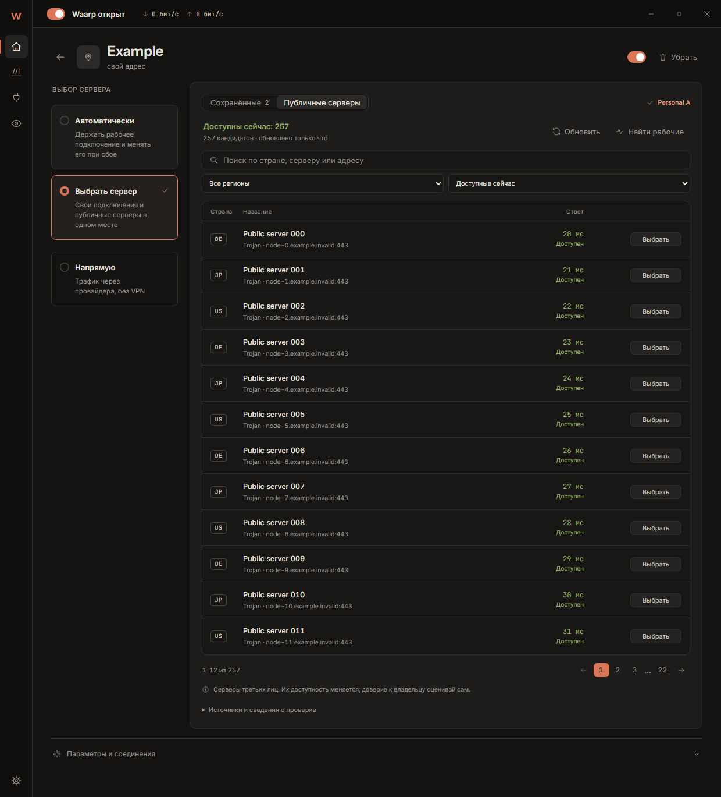
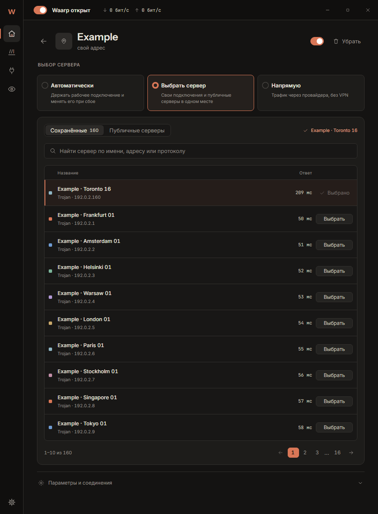
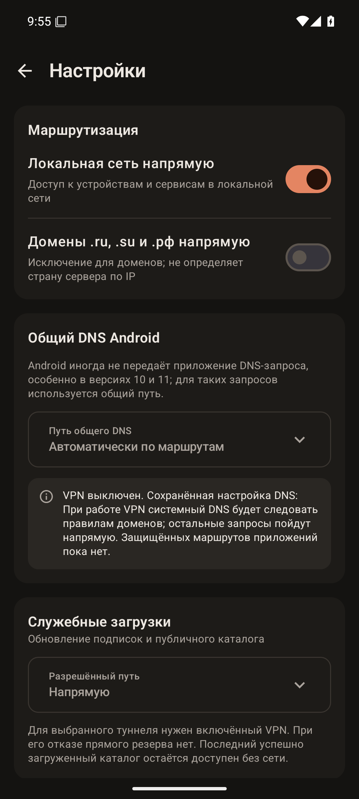
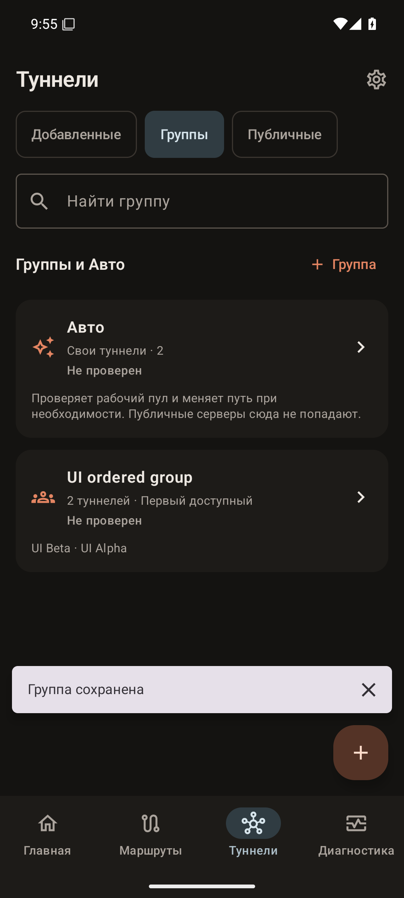

<p align="center">
  
</p>

<p align="center">
  <a href="README.md"><b>English</b></a> · <a href="README.ru.md">Русский</a>
</p>

<p align="center">
  
  
  <a href="LICENSE"></a>
  <a href="android/LICENSE"></a>
  
</p>

<p align="center">
  <strong>One place to route apps, sites and services through the connection you choose.</strong><br>
  Personal VPNs, proxies, groups, failover and an opt-in public catalog — without a paid Waarp subscription.
</p>

<p align="center">
  <a href="#download"><b>Download</b></a> ·
  <a href="#screenshots">Screenshots</a> ·
  <a href="#why-waarp">Features</a> ·
  <a href="docs/README.md">Documentation</a> ·
  <a href="README.ru.md">Русский</a> ·
  <a href="ROADMAP.md">Roadmap</a>
</p>

> [!IMPORTANT]
> **Windows EXE and Android APK previews are available.** The [18 November preview](https://github.com/INNVoices/waarp/releases/tag/preview-2026-11-18-r3) includes Windows `0.4.1-rc.3` and Android `0.5.0-rc.4` from the same verified source commit. The EXE is unsigned; the APKs are debug-signed. This is a prerelease, not an approved stable build. [Versions, checksums and release criteria](docs/RELEASES.md).

<p align="center">
  <a href="docs/screenshots/server-picker.png"></a>
</p>
<p align="center"><sub>Windows 0.4.1-rc.3 production renderer in Chromium with synthetic test profiles. Shown availability and latency are fixture data.</sub></p>

## Why Waarp

| **Precise routing** | **Stable path selection** | **Useful diagnostics** |
| :--- | :--- | :--- |
| Assign a direct or protected path to apps, services, domains and custom targets. | Auto holds a working personal route; explicit failover avoids reflexive ping-based switching. | Check a target through your connections and explain observed DNS, TCP, TLS and HTTP failures. |
| **Bring your own connections** | **Public pool, by choice** | **Desktop + mobile** |
| WireGuard / AmneziaWG, VLESS, VMess, Trojan, Shadowsocks, Hysteria2, TUIC, OpenVPN and supported imports. | On Windows, browse current availability, search the full pool and check a chosen server while the VPN stays on. Public relays never join Auto silently. | Electron-based Windows client and native Kotlin / Compose Android client in one repository. |

No multi-path aggregation, no guaranteed latency improvement, and no anonymity promise. [How routing works](#how-it-works) · [Public node trust and sources](docs/SOURCES.md).

## Download

|  |  |
| :--- | :--- |
| **[Download 0.4.1-rc.3 portable EXE](https://github.com/INNVoices/waarp/releases/download/preview-2026-11-18-r3/Waarp-0.4.1-rc.3-portable.exe)** | **[Download 0.5.0-rc.4 APK · ARM64](https://github.com/INNVoices/waarp/releases/download/preview-2026-11-18-r3/waarp-android-0.5.0-rc.4-arm64-v8a-debug.apk)** |
| Windows 10/11 x64. Portable, unsigned preview with the new server picker and live card changes. [SHA-256](https://github.com/INNVoices/waarp/releases/download/preview-2026-11-18-r3/SHA256SUMS-windows.txt). | Android 10+. Installable **debug-signed** preview; ARM64 suits most current phones. Separate from the production app and cannot update it. [SHA-256](https://github.com/INNVoices/waarp/releases/download/preview-2026-11-18-r3/SHA256SUMS-android-debug.txt). |

Other Android builds: **[ARM32](https://github.com/INNVoices/waarp/releases/download/preview-2026-11-18-r3/waarp-android-0.5.0-rc.4-armeabi-v7a-debug.apk)** · **[x86_64](https://github.com/INNVoices/waarp/releases/download/preview-2026-11-18-r3/waarp-android-0.5.0-rc.4-x86_64-debug.apk)**. [Release notes and all assets](https://github.com/INNVoices/waarp/releases/tag/preview-2026-11-18-r3) · [Passing preview checks](https://github.com/INNVoices/waarp/actions/runs/44276974976).

**[All releases](https://github.com/INNVoices/waarp/releases)** · **[Preview publishing workflow](.github/workflows/release-preview.yml)** · **[Release and integrity guide](docs/RELEASES.md)**

The repo is currently private; GitHub download and Actions links may require repository access. Third-party infrastructure can cost money, even though Waarp itself has no subscription.

## New in Windows 0.4.1-rc.3

Choose an application, then choose its server in one screen: **Automatic · Manual · Direct**. Saved connections and public servers use compact rows, search and numbered pages. The public catalogue adds region and availability filters and shows current availability separately from stored candidates; selecting a candidate checks its connection before use.

Public checks can run while Waarp is on. Changing a card's server updates the route without asking to restart the VPN; a failed live change keeps the previous selection. The initial app chooser stays familiar, with route diagrams and advanced settings tucked under one details section.

[What changed and how it behaves](docs/SERVER-SELECTION-2026-11-18.md) · [Preview notes](release/preview-2026-11-18.md)

## New connection tools in main

The current source embeds a local map in the existing Windows and Android connection pickers. Search and filters stay in place; choosing a region filters the selectable rows. A check opened from a card compares responses from its target through eligible connections, explains the result and applies a chosen path to that card. On Android, the result stays in the draft until the single Save route action.

Windows also holds active paths during optional changes and gives explicit user actions priority. These changes are being prepared for the next release; the download links above refer to the published `r3` preview. [Usage](docs/CONNECTION-TOOLS.md) · [Actual checks and limits](docs/planning/WAARP-NEXT-2026-11-18/08-IMPLEMENTATION.md) · [Contribute a profile](docs/CONNECTION-PROFILES.md).

## How it works

Waarp does not put the whole computer behind one VPN. Each target gets its own intent:

- **Direct** — the normal network;
- **a specific connection** — one of your own VPN / proxy profiles, or a group of them;
- **Auto** — picks from your own eligible connections and stays on a working one.

Targets can be applications, services or custom hosts. A whole-computer mode routes everything else through a chosen path while explicit rules still apply.

### Auto

Auto is built to be predictable, not to re-optimise every few seconds:

- only your own non-public connections take part;
- a healthy path stays in use while it has active connections; one missed probe does not switch it;
- switching for better performance happens only when the current path has no active connections and repeated checks show a clear improvement; confirmed failure can trigger failover;
- probing is bounded, and the engine keeps at most **16** Auto connections live at once, so a library of hundreds of profiles does not hold hundreds of tunnels in memory (the others stay in your library and remain usable manually and in diagnostics);
- Auto never falls back to Direct or to a public node. With no eligible path, the route stays unavailable instead of leaking.

Failover closes the affected sessions so traffic can use the replacement path. Games and other apps may need to reconnect.

### Diagnostics

Waarp checks a target through eligible connections and reports the observed failure stage: DNS, TCP, TLS or HTTP. Detailed system checks follow operating-system routes and can traverse the active VPN. Checks of specific connections address their native outbound. One failed request does not establish a cause such as provider blocking. With the tunnel closed, a separate local checker probes a bounded set of your connections without creating a TUN or touching system routes.

Displayed latency measures an HTTP check, not game-server ping. Waarp selects a path for each route; it does not send a session through several paths at once (multipath).

### Supported connections

Engine: [sing-box-lx](https://github.com/Leadaxe/sing-box-lx) (bundled, with its license, under `engine/`).

- AmneziaWG / WireGuard
- VLESS, VMess, Trojan, Shadowsocks
- Hysteria2, TUIC v5
- OpenVPN (scripts, plugins and external credential files are rejected)
- subscriptions with supported share links, including JSON / YAML containers containing those links

Import from file, clipboard, QR code, subscription link, local discovery or manual entry. Subscription refresh is manual. JSON / YAML import extracts supported share links; it does not convert arbitrary native client configurations.

On Windows `0.4.1-rc.3`, public discovery starts when you open the public-server section or explicitly refresh/check it; no catalog probes run just because the app starts or on a periodic schedule. Opening a catalogue with no fresh results starts one bounded search. An unverified or stale candidate receives an individual check before use, including while the main VPN is running. Android `0.5.0-rc.4` has a separate catalogue flow: new public-node probes still require VPN OFF. On both platforms, public nodes remain a separate source and never join Auto silently. Those nodes are run by third parties, not Waarp; their operators may log traffic that is not end-to-end encrypted. Sources: [docs/SOURCES.md](docs/SOURCES.md).

## Screenshots

### Windows · server selection

<!-- Publish the current gallery only with the reviewed PNGs listed in docs/screenshots/README.md. -->
<table>
<tr>
<td align="center" valign="top" width="50%"><a href="docs/screenshots/public-server-pages.png"></a><br><sub><strong>Public servers</strong> · 12 per page, search across the full pool</sub></td>
<td align="center" valign="top" width="50%"><a href="docs/screenshots/saved-server-pages.png"></a><br><sub><strong>Saved connections</strong> · 10 per page, selected server highlighted</sub></td>
</tr>
</table>

These captures use the built production UI with synthetic profiles and status supplied by the renderer tests. They show layout and interaction states; they do not establish remote-server availability. Open an image for its full-size view.

### Android · native app

<p align="center">
  <a href="docs/screenshots/android-home.png"></a>
  <a href="docs/screenshots/android-settings.png"></a>
  <a href="docs/screenshots/android-groups.png"></a>
</p>
<p align="center"><sub>Home · Settings · Groups</sub></p>

Android 0.5.0-rc.4 captured from the native app on an API 35 Pixel 6 emulator with synthetic test profiles. [Capture methods and sources](docs/screenshots/README.md).

<details>
<summary>Earlier Windows captures</summary>

The original [overview](docs/screenshots/hero-home.png), [route settings](docs/screenshots/routing.png), [connection import](docs/screenshots/add-connection.png) and [diagnostics](docs/screenshots/diagnostics.png) remain available as historical UI references. They predate the current server picker.

</details>

## Conservative Windows failure handling

Waarp is designed to avoid leaving network state behind and to refuse a start when the state is ambiguous:

- before every start it checks, read-only, for a leftover Waarp adapter or a taken service subnet, and refuses to start rather than change anything;
- stopping tries a verified CTRL_BREAK only when an isolated console is available; otherwise it terminates only its own child through the retained handle, then verifies exit;
- it never deletes network adapters, resets Winsock or DNS, or touches another VPN;
- after sleep it restarts at most once, and only when a usable network is back.

Coverage includes offline regressions, native Windows process checks and production-renderer checks. Native TUN lifecycle and protocol tests have separate evidence and boundaries. Physical sleep, shutdown, full routing, other-VPN coexistence and the private remote endpoint require the [stable acceptance matrix](docs/STABLE-AUDIT-2026-11-16.md). Actual results are in [the validation record](docs/VALIDATION-2026-11-16.md); the failure contract is in [docs/RELIABILITY.md](docs/RELIABILITY.md).

## Security model

- Electron sandbox, context isolation, no Node integration in the UI.
- VPN secrets are stored with Windows DPAPI; there is no plain-text fallback.
- The bundled engine and its DLL are checked against expected hashes before every start.
- Imported configs are validated before they reach the engine.
- Missing or revoked routes stay blocked instead of becoming Direct.
- A small local bridge lets companion desktop apps request routing for their own target with a per-run token; it never exposes configs or keys. See [docs/BRIDGE.md](docs/BRIDGE.md).

Waarp is a routing tool, not an anonymity guarantee: a connection provider can still see traffic that passes through it.

**DNS protection while running; no independent kill switch.** The tunnel uses temporary Windows DNS filtering (`strict_route`) to limit DNS requests outside the tunnel. This filter depends on the running engine. Waarp does not enforce a separate persistent firewall kill switch; if the engine crashes, Windows may send traffic over its normal route. Do not treat Waarp as leak-proof.

Security issues: please follow [SECURITY.md](SECURITY.md) instead of opening a public issue.

## Build from source

For Android, see the [SDK, build, installation and signing guide](docs/ANDROID.md#build-and-install). The commands below build the Windows desktop app.

Windows 10/11, Node.js. Administrator rights are needed only when the tunnel starts.

```bash
npm ci
npm run dev
```

Checks (all offline):

```bash
npm run typecheck
npm test
npm run check
npm run build
npm run test:performance
```

`npm run test:ui` serves the built production renderer for Playwright automatically (install Chromium first with `npx playwright install chromium`).

`npm run test:live -- --disposable-windows` creates a real temporary TUN on an administrator Windows test machine and verifies cleanup across 50 cycles. It intentionally disables automatic routes and DNS capture. Run it only on a disposable test machine; it does not establish remote connectivity or full-system routing. The opt-in real-connection runner and AWG library harness are documented in [the validation record](docs/VALIDATION-2026-11-16.md).

## Contributing

See [CONTRIBUTING.md](CONTRIBUTING.md).

Bug reports, routing edge cases and Windows or Android failures are useful even when you do not have a fix. Include the platform and OS version. Please remove keys, subscription URLs, tokens, private server addresses and other secrets before posting logs or screenshots.

## Credits

- [sing-box-lx](https://github.com/Leadaxe/sing-box-lx), based on [sing-box](https://github.com/SagerNet/sing-box) — networking engine, shipped as a separate executable; license: see [`engine/LICENSE`](engine/LICENSE), provenance: [`engine/SOURCE.md`](engine/SOURCE.md)
- [Electron](https://www.electronjs.org/), [React](https://react.dev/), [Vite](https://vitejs.dev/)
- [Instrument Sans](https://github.com/Instrument/instrument-sans), [Inter](https://rsms.me/inter/), [JetBrains Mono](https://www.jetbrains.com/lp/mono/) — SIL Open Font License
- [Simple Icons](https://simpleicons.org/) — CC0

Full list: [THIRD_PARTY_NOTICES.md](THIRD_PARTY_NOTICES.md).

ExitLag is a trademark of its respective owner. Waarp is an independent project and is not affiliated with ExitLag.

## License

| Component | License |
| --- | --- |
| Waarp desktop application | [Apache License 2.0](LICENSE), with [NOTICE](NOTICE) |
| Waarp Android application | [GNU GPL 3.0 or later](android/LICENSE), with [Android notices](android/app/src/main/assets/licenses/NOTICE.txt) |

The desktop license does not apply to the Android application.
Bundled third-party components keep their own licenses: the sing-box-lx engine ships as a separate program under its own license (GPL-3.0-or-later text plus an upstream naming/association condition, see [`engine/LICENSE`](engine/LICENSE)), see [THIRD_PARTY_NOTICES.md](THIRD_PARTY_NOTICES.md). Engine binaries are not stored in Git: `npm run engine:fetch` downloads and verifies the pinned release, `npm run dist` refuses to package without them.
