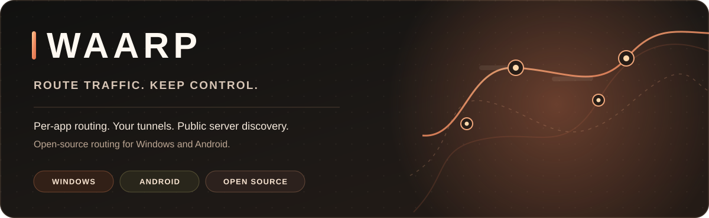
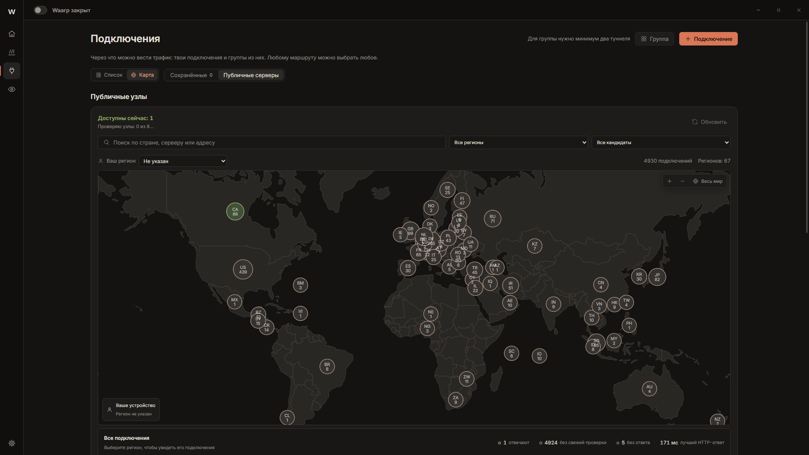
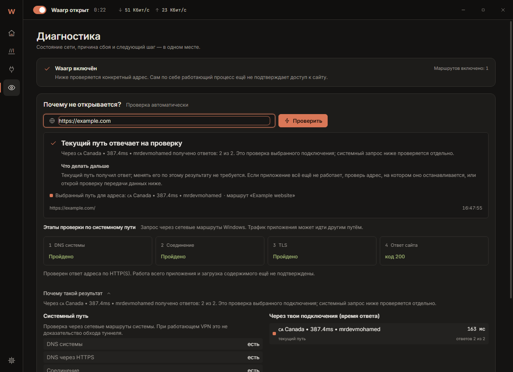
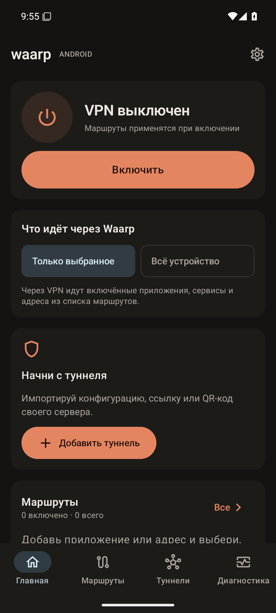
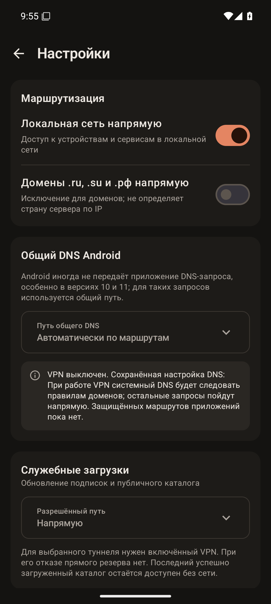
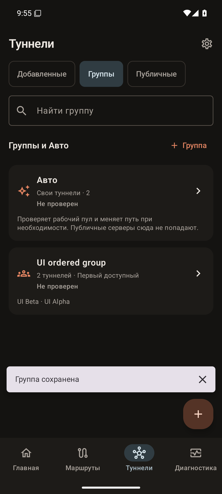

<p align="center">
  
</p>

<p align="center">
  <a href="README.md">English</a> · <a href="README.ru.md"><b>Русский</b></a>
</p>

<p align="center">
  
  
  <a href="LICENSE"></a>
  <a href="android/LICENSE"></a>
  
</p>

<p align="center">
  <strong>Управляйте маршрутами приложений, сайтов и сервисов в одном месте.</strong><br>
  Собственные VPN и прокси, группы, резервирование и публичный каталог по запросу — без подписки Waarp.
</p>

<p align="center">
  <a href="#скачать"><b>Скачать</b></a> ·
  <a href="#скриншоты">Скриншоты</a> ·
  <a href="#возможности">Возможности</a> ·
  <a href="docs/README.md">Документация</a> ·
  <a href="README.md">English</a> ·
  <a href="ROADMAP.md">Roadmap</a>
</p>

> [!IMPORTANT]
> **Windows r6 опубликован как предварительный выпуск.** Версия обновления ПК — `0.4.1-rc.5`; Android остаётся опубликованным `0.5.0-rc.5` из [r5](https://github.com/INNVoices/waarp/releases/tag/preview-2026-11-18-r5). У этих загрузок разные исходные коммиты. EXE без цифровой подписи, APK подписаны debug-ключом. [Состояние выпуска, хеши и критерии](docs/RELEASES.md).

[Проверки выпуска Windows](https://github.com/INNVoices/waarp/actions/runs/44348809024) прошли: реальные публичные проверки до добавления и при включённом VPN, сохранение маршрута и сессии, размеры карты, диагностика, загруженный значок и 50 циклов TUN. На runner GitHub свежий ответ был у 4 из 14 проверенных публичных кандидатов; первое рабочее подключение подтверждено через 102,737 с от начала сценария каталога на чистой установке. Отдельный тест жизненного цикла в общем CI на том же исходном коде завершился ошибкой; [измеренные результаты и неустранённые ограничения](docs/RELEASES.md#current-evidence-and-unresolved-limits).

<p align="center">
  <a href="docs/screenshots/preview-r6/desktop-public-real-1920.png"></a>
</p>
<p align="center"><sub>Windows r6: кадры опубликованного упакованного приложения на Windows-runner GitHub. Доступность публичных серверов относится к сети и моменту этой съёмки.</sub></p>

## Возможности

| **Маршрутизация по правилам** | **Стабильный выбор пути** | **Диагностика без догадок** |
| :--- | :--- | :--- |
| Отдельные маршруты для приложений, сервисов, доменов и других целей. | «Авто» держит рабочий личный маршрут и не перескакивает при каждом изменении ping. | Проверка нужного адреса через свои подключения и объяснение наблюдаемых DNS, TCP, TLS и HTTP ошибок. |
| **Свои подключения** | **Публичный пул по желанию** | **Windows и Android** |
| WireGuard / AmneziaWG, VLESS, VMess, Trojan, Shadowsocks, Hysteria2, TUIC, OpenVPN и поддерживаемый импорт. | В Windows проверка начинается при открытии каталога, в том числе при включённом VPN. Видимые кандидаты получают приоритет без добавления в сохранённые подключения. Публичные серверы не попадают в «Авто» сами. | Десктоп-клиент Electron и нативный Android-клиент Kotlin / Compose в одном проекте. |

Нет multipath-агрегации, гарантии снижения задержки или обещания анонимности. [Принцип работы](#как-это-работает) · [Доверие и источники публичных узлов](docs/SOURCES.md).

## Скачать

|  |  |
| :--- | :--- |
| **[Скачать 0.4.1-rc.5 EXE](https://github.com/INNVoices/waarp/releases/download/preview-2026-11-18-r6/Waarp-0.4.1-rc.5-portable.exe)** | **[Скачать 0.5.0-rc.5 APK · ARM64](https://github.com/INNVoices/waarp/releases/download/preview-2026-11-18-r5/waarp-android-0.5.0-rc.5-arm64-v8a-debug.apk)** |
| Windows 10/11 x64. Portable без цифровой подписи: автоматические проверки, понятнее диагностика, более высокая карта и значок в панели задач. [SHA-256](https://github.com/INNVoices/waarp/releases/download/preview-2026-11-18-r6/SHA256SUMS-windows.txt). | Android 10+. Устанавливаемая версия **с debug-подписью**; ARM64 подходит большинству современных телефонов. Ставится отдельно от производственного приложения и не обновляет его. [SHA-256](https://github.com/INNVoices/waarp/releases/download/preview-2026-11-18-r5/SHA256SUMS-android-debug.txt). |

Другие сборки Android: **[ARM32](https://github.com/INNVoices/waarp/releases/download/preview-2026-11-18-r5/waarp-android-0.5.0-rc.5-armeabi-v7a-debug.apk)** · **[x86_64](https://github.com/INNVoices/waarp/releases/download/preview-2026-11-18-r5/waarp-android-0.5.0-rc.5-x86_64-debug.apk)**. [Выпуск Android r5](https://github.com/INNVoices/waarp/releases/tag/preview-2026-11-18-r5). Windows r6: [выпуск](https://github.com/INNVoices/waarp/releases/tag/preview-2026-11-18-r6) · [проверки выпуска](https://github.com/INNVoices/waarp/actions/runs/44348809024) · [проверка пакета](https://github.com/INNVoices/waarp/releases/download/preview-2026-11-18-r6/package-integrity-windows.json) · [приёмка на публичной сети](https://github.com/INNVoices/waarp/releases/download/preview-2026-11-18-r6/public-catalog-windows.json).

**[Все релизы](https://github.com/INNVoices/waarp/releases)** · **[Workflow предварительных выпусков](.github/workflows/release-preview.yml)** · **[Правила релизов и проверки хешей](docs/RELEASES.md)**

Репозиторий сейчас приватный: для загрузок и CI может потребоваться доступ к нему. Сторонние VPN/VPS и прокси могут быть платными.

## Выбор сервера в Windows

После выбора программы открывается единый выбор сервера: **«Автоматически» · «Выбрать сервер» · «Напрямую»**. Сохранённые подключения и публичные серверы представлены компактными строками с поиском и нумерованными страницами. В публичном каталоге также есть фильтры региона и доступности. Сначала проверяются видимые кандидаты, затем ограниченными раундами — остальные, пока открыт публичный раздел. Проверка не добавляет профиль: после свежего ответа строка предлагает «Добавить» или «Использовать». Прогресс различает ожидающих, ответивших, не ответивших и пропущенных кандидатов.

Проверки публичных серверов доступны при включённом Waarp. Смена сервера в карточке применяется без предложения перезапустить VPN; если применить изменение не удалось, прежний выбор сохраняется. Начальный выбор программы остаётся прежним, а схема маршрута и дополнительные настройки доступны в раскрывающемся разделе.

[Описание поведения](docs/SERVER-SELECTION-2026-11-18.md) · [Изменения предварительного выпуска](release/preview-2026-11-18.md)

## Карта и проверка подключения

В Windows `0.4.1-rc.5` карта получила больше места по высоте, сводку по регионам и измеренному состоянию. При сохранении публичного подключения сохраняется распознанная страна. Узлы без известного региона остаются в списке. География встроена в приложение; маркеры стран и линии маршрутов показывают логические связи, а не точные координаты серверов и не traceroute.

Главная вкладка диагностики автоматически начинает ограниченное расследование, объясняет наблюдаемый этап и предлагает следующий шаг. Она учитывает существующий маршрут домена или путь по умолчанию и сохраняет отвечающее текущее подключение. Результат конкретного подключения показан отдельно от системного запроса Windows. Проверка передачи данных и история ответов доступны в раскрываемом разделе.

Android остаётся на r5: прежняя локальная карта, сохранение выбранного региона и контекстная проверка подключения. Её результат остаётся в форме до «Сохранить маршрут». [Как пользоваться](docs/CONNECTION-TOOLS.md) · [Доказательства и ограничения выпуска](docs/RELEASES.md) · [Историческая галерея r5 и происхождение кадров](docs/screenshots/preview-r5/README.md) · [Внести свой профиль](docs/CONNECTION-PROFILES.md).

## Как это работает

Waarp не загоняет весь компьютер в один VPN. У каждой цели своё намерение:

- **Напрямую** — обычная сеть;
- **конкретное подключение** — ваш VPN или прокси, либо их группа;
- **Авто** — выбирает из ваших подходящих подключений и держится за рабочее.

Цели: приложения, сервисы или свои адреса. Режим «весь компьютер» ведёт всё остальное через выбранный путь, а явные правила продолжают работать.

### Авто

Авто предсказуемо и не переоптимизирует маршрут каждые несколько секунд:

- участвуют только ваши непубличные подключения;
- рабочий путь сохраняется, пока через него есть активные соединения; одна пропущенная проверка его не переключает;
- ради скорости путь меняется только при отсутствии активных соединений и после стабильно и заметно лучших результатов проверок; подтверждённый отказ может вызвать переход на резерв;
- проверки ограничены, а движок держит не больше **16** подключений Авто одновременно, поэтому библиотека из сотен профилей не держит сотни туннелей в памяти (остальные остаются в библиотеке, их можно выбрать вручную и проверить в диагностике);
- Авто никогда не уходит в «Напрямую» или на публичный узел. Если подходящего пути нет, маршрут остаётся недоступным, а не утекает.

При переходе на резерв затронутые соединения закрываются, чтобы трафик мог пойти новым путём. Игре или другому приложению может понадобиться переподключение.

### Диагностика

В Windows открытие диагностики или изменение адреса автоматически запускает ограниченную проверку. Waarp показывает наблюдаемый этап — DNS, TCP, TLS или HTTP — с конкретным следующим действием и сравнением допустимых путей. При наличии подходящего доменного маршрута проверка учитывает его; имя приложения не превращается в предполагаемый домен. Подробная системная проверка следует маршрутам операционной системы; при включённом VPN она может проходить через туннель. Проверки конкретных подключений адресуются их native outbound. Причина вроде блокировки провайдером не выводится из одного неудачного запроса. Когда туннель закрыт, отдельная локальная проверка смотрит ограниченный набор ваших подключений без TUN и изменения маршрутов системы.

Показанная задержка — время HTTP-проверки, а не пинг до игрового сервера. Waarp выбирает путь для каждого маршрута; передача одной сессии по нескольким путям одновременно (multipath) не реализована.

### Поддерживаемые подключения

Движок: [sing-box-lx](https://github.com/Leadaxe/sing-box-lx) (в комплекте, с лицензией, в `engine/`).

- AmneziaWG / WireGuard
- VLESS, VMess, Trojan, Shadowsocks
- Hysteria2, TUIC v5
- OpenVPN (скрипты, плагины и внешние файлы ключей отклоняются)
- подписки с поддерживаемыми ссылками подключений, в том числе JSON / YAML с такими ссылками

Импорт из файла, буфера обмена, QR-кода, ссылки подписки, поиска на компьютере или вручную. Подписки обновляются вручную. Из JSON / YAML извлекаются поддерживаемые ссылки подключений; произвольные конфигурации других клиентов не преобразуются.

В Windows `0.4.1-rc.5` публичные кандидаты проверяются автоматически, пока открыт экран каталога. Видимые строки имеют приоритет; остальные проверяются ограниченными раундами с паузами и ожиданием перед повторной попыткой. Уход с публичного экрана снимает его запрос на автоматическую проверку. Ноль доступных серверов описывает текущие измерения, а не отказ всех сохранённых кандидатов. Проверки не добавляют профили и не меняют выбранный маршрут приложения. В Android `0.5.0-rc.5` каталог работает отдельно: для новых проверок публичных узлов пока требуется выключенный VPN. На обеих платформах публичные узлы отделены от «Авто». Их держат третьи лица, не Waarp; операторы могут видеть трафик без сквозного шифрования. Источники: [docs/SOURCES.md](docs/SOURCES.md).

## Скриншоты

Кадры Windows r6 ниже получены из упакованного EXE коммита `0e0bb6c7cad421dc0fff377d8c7f826d115e0292` с реальными публичными источниками и нативными проверками на Windows-runner GitHub. [Отчёт приёмки](docs/screenshots/preview-r6/public-catalog-windows.json). [Галерея r5](docs/screenshots/preview-r5/README.md) сохраняет историю Windows-кадров с тестовыми данными и актуальные кадры карты Android при обычном и увеличенном до 150% шрифте.

### Windows · автоматические проверки и диагностика

<table>
<tr>
<td align="center" valign="top" width="50%"><a href="docs/screenshots/preview-r6/desktop-public-real-1920.png"></a><br><sub><strong>Публичные подключения</strong> · проверяются до добавления</sub></td>
<td align="center" valign="top" width="50%"><a href="docs/screenshots/preview-r6/desktop-diagnostics-real-1240.png"></a><br><sub><strong>Диагностика</strong> · путь, наблюдения и следующий шаг</sub></td>
</tr>
</table>

Эти кадры r6 получены из упакованного Windows-приложения вместе с соответствующим [отчётом приёмки на публичной сети](https://github.com/INNVoices/waarp/releases/download/preview-2026-11-18-r6/public-catalog-windows.json). Измерения на runner GitHub не доказывают доступность на другой сети. Старые кадры [публичного](docs/screenshots/public-server-pages.png) и [сохранённого](docs/screenshots/saved-server-pages.png) выбора сервера остаются историей компоновки с тестовыми данными.

### Android · нативное приложение

<p align="center">
  <a href="docs/screenshots/android-home.png"></a>
  <a href="docs/screenshots/android-settings.png"></a>
  <a href="docs/screenshots/android-groups.png"></a>
</p>
<p align="center"><sub>Главная · Настройки · Группы</sub></p>

Android 0.5.0-rc.4: кадры нативного приложения на эмуляторе Pixel 6 с API 35 и тестовыми профилями. [Способ съёмки и источники](docs/screenshots/README.md).

<details>
<summary>Предыдущие кадры Windows</summary>

Исходные снимки [главного экрана](docs/screenshots/hero-home.png), [настройки маршрута](docs/screenshots/routing.png), [импорта подключений](docs/screenshots/add-connection.png) и [диагностики](docs/screenshots/diagnostics.png) сохранены как история интерфейса. Они сделаны до обновления выбора сервера.

</details>

## Осторожное поведение при сбоях Windows

Waarp старается не оставлять после себя изменений в сети и не запускается, если состояние неясно:

- перед каждым запуском он только читает состояние сети: если остался адаптер Waarp или занята его служебная подсеть, он не запускается и ничего не меняет;
- остановка пробует проверенный CTRL_BREAK только при наличии отдельной консоли; иначе завершает свой дочерний процесс через сохранённый handle, затем проверяет выход;
- он никогда не удаляет сетевые адаптеры, не сбрасывает Winsock и DNS и не трогает другой VPN;
- после сна перезапускается не больше одного раза и только когда сеть вернулась.

Покрытие включает офлайн-регрессии, нативные проверки процессов Windows и production-интерфейса. У TUN lifecycle и протокольных тестов отдельные доказательства и границы. Физический сон, выключение, полная маршрутизация, другой VPN и приватный endpoint требуют [закрытия критериев stable](docs/STABLE-AUDIT-2026-11-16.md). Фактические результаты: [журнал проверок](docs/VALIDATION-2026-11-16.md). Контракт отказов: [docs/RELIABILITY.md](docs/RELIABILITY.md).

## Безопасность

- Песочница Electron, изоляция контекста, без Node в интерфейсе.
- Ключи VPN хранятся через Windows DPAPI, без запасного хранения открытым текстом.
- Движок и его DLL сверяются с ожидаемыми хешами перед каждым запуском.
- Импортированные конфиги проверяются до того, как попадут в движок.
- Удалённые и отозванные маршруты остаются заблокированными, а не становятся «Напрямую».
- Небольшой локальный мост позволяет другим приложениям на этом компьютере попросить маршрут для своей цели по токену на один запуск; конфиги и ключи он не отдаёт. См. [docs/BRIDGE.md](docs/BRIDGE.md).

Waarp — инструмент маршрутизации, а не гарантия анонимности: владелец подключения всё равно видит трафик, который через него идёт.

**Защита DNS во время работы; независимого kill switch нет.** Туннель использует временную фильтрацию DNS в Windows (`strict_route`), чтобы ограничить DNS-запросы вне туннеля. Фильтр зависит от работающего движка. Отдельной постоянной блокировки через брандмауэр нет; если движок упадёт, Windows может пустить трафик обычным путём. Не считайте Waarp защитой от утечек.

Об уязвимостях сообщайте по [SECURITY.md](SECURITY.md), а не в публичном issue.

## Сборка из исходников

Для Android есть [инструкция по SDK, сборке, установке и подписи](docs/ANDROID.md#build-and-install). Команды ниже относятся к приложению для Windows.

Windows 10/11, Node.js. Права администратора нужны только при запуске туннеля.

```bash
npm ci
npm run dev
```

Проверки (все офлайн):

```bash
npm run typecheck
npm test
npm run check
npm run build
npm run test:performance
```

`npm run test:ui` самостоятельно запускает локальный сервер production-интерфейса для Playwright. Chromium устанавливается командой `npx playwright install chromium`.

`npm run test:live -- --disposable-windows` создаёт настоящий временный TUN в Windows с правами администратора и проверяет очистку в 50 циклах. Автоматические маршруты и захват DNS отключены. Запускайте только на одноразовой тестовой машине; этот сценарий не доказывает удалённое соединение или полную маршрутизацию. Проверки реального подключения и AWG-библиотеки описаны в [журнале проверок](docs/VALIDATION-2026-11-16.md).

## Участие

См. [CONTRIBUTING.md](CONTRIBUTING.md).

Репорты о багах, странных маршрутах и проблемах Windows или Android полезны даже без готового фикса. Укажите платформу и версию ОС. Перед публикацией логов и скриншотов удалите ключи, ссылки подписок, токены, приватные адреса серверов и другие секреты.

## Благодарности

- [sing-box-lx](https://github.com/Leadaxe/sing-box-lx) на основе [sing-box](https://github.com/SagerNet/sing-box) — сетевой движок, поставляется отдельным исполняемым файлом; лицензия: [`engine/LICENSE`](engine/LICENSE), происхождение: [`engine/SOURCE.md`](engine/SOURCE.md)
- [Electron](https://www.electronjs.org/), [React](https://react.dev/), [Vite](https://vitejs.dev/)
- [Instrument Sans](https://github.com/Instrument/instrument-sans), [Inter](https://rsms.me/inter/), [JetBrains Mono](https://www.jetbrains.com/lp/mono/) — SIL Open Font License
- [Simple Icons](https://simpleicons.org/) — CC0

Полный список: [THIRD_PARTY_NOTICES.md](THIRD_PARTY_NOTICES.md).

ExitLag — товарный знак своего владельца. Waarp — независимый проект и не связан с ExitLag.

## Лицензия

| Компонент | Лицензия |
| --- | --- |
| Десктоп-приложение Waarp | [Apache License 2.0](LICENSE), см. [NOTICE](NOTICE) |
| Android-приложение Waarp | [GNU GPL 3.0 или новее](android/LICENSE), см. [уведомления Android](android/app/src/main/assets/licenses/NOTICE.txt) |

Лицензия десктоп-приложения не распространяется на Android-приложение.
Сторонние компоненты сохраняют свои лицензии: движок sing-box-lx поставляется отдельной программой под собственной лицензией (текст GPL-3.0-or-later плюс условие upstream об использовании названия и упоминании связи, см. [`engine/LICENSE`](engine/LICENSE)), см. [THIRD_PARTY_NOTICES.md](THIRD_PARTY_NOTICES.md). Бинарники движка не хранятся в Git: `npm run engine:fetch` скачивает и проверяет закреплённый релиз, `npm run dist` без них не собирает.
