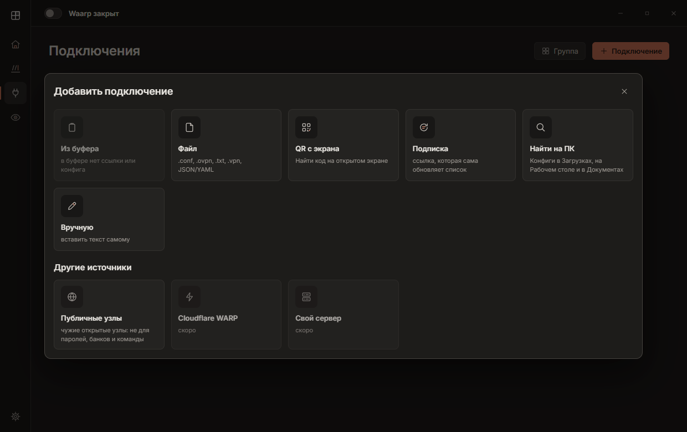

<p align="center">
  
</p>

<p align="center">
  <a href="README.md">English</a> · <a href="README.ru.md"><b>Русский</b></a>
</p>

<p align="center">
  
  
  <a href="LICENSE"></a>
  <a href="android/LICENSE"></a>
  
</p>

<p align="center">
  <strong>Управляйте маршрутами приложений, сайтов и сервисов в одном месте.</strong><br>
  Собственные VPN и прокси, группы, резервирование и публичный каталог по запросу — без подписки Waarp.
</p>

<p align="center">
  <a href="#скачать"><b>Скачать</b></a> ·
  <a href="#скриншоты">Скриншоты</a> ·
  <a href="#возможности">Возможности</a> ·
  <a href="docs/README.md">Документация</a> ·
  <a href="README.md">English</a> ·
  <a href="ROADMAP.md">Roadmap</a>
</p>

> [!IMPORTANT]
> **Текущий исходный код — кандидат в релиз, а не утверждённая stable-версия.** Опубликованный EXE относится к более ранней бете; подписанного производственного APK для Android пока нет. [Версии, хеши и требования к выпуску](docs/RELEASES.md).

<p align="center">
  
</p>
<p align="center"><sub>Скриншот Windows из репозитория. Текущий RC-интерфейс может немного отличаться.</sub></p>

## Возможности

| **Маршрутизация по правилам** | **Стабильный выбор пути** | **Диагностика без догадок** |
| :--- | :--- | :--- |
| Отдельные маршруты для приложений, сервисов, доменов и других целей. | «Авто» держит рабочий личный маршрут и не перескакивает при каждом изменении ping. | Сравнение Direct и своих подключений: DNS, TCP, TLS и HTTP. |
| **Свои подключения** | **Публичный пул по желанию** | **Windows и Android** |
| WireGuard / AmneziaWG, VLESS, VMess, Trojan, Shadowsocks, Hysteria2, TUIC, OpenVPN и поддерживаемый импорт. | Реальная доступность, поиск по всему пулу и проверка выбранного сервера при включённом VPN. Публичные серверы не попадают в «Авто» сами. | Десктоп-клиент Electron и нативный Android-клиент Kotlin / Compose в одном проекте. |

Нет multipath-агрегации, гарантии снижения задержки или обещания анонимности. [Принцип работы](#как-это-работает) · [Доверие и источники публичных узлов](docs/SOURCES.md).

## Скачать

|  |  |
| :--- | :--- |
| **[Скачать v0.4.0 Portable EXE](https://github.com/INNVoices/waarp/releases/download/v0.4.0/Waarp-0.4.0-portable.exe)** · [Описание релиза](https://github.com/INNVoices/waarp/releases/tag/v0.4.0) | **Android 0.5.0-rc.4** находится в исходниках. [Сборка и установка](docs/ANDROID.md#build-and-install) · [Android CI](https://github.com/INNVoices/waarp/actions/workflows/android.yml) |
| Опубликованная бета для Windows 10/11 x64. Исходники **0.4.1-rc.3** и описание изменений готовы; выпуск остаётся черновиком до успешной сборки и проверки публикации. | Debug APK можно устанавливать для тестов после успешной сборки. **Release-unsigned APK нельзя установить**; производственная подпись и приёмка — отдельный этап. |

**[Все релизы](https://github.com/INNVoices/waarp/releases)** · **[Workflow предварительных выпусков](.github/workflows/release-preview.yml)** · **[Правила релизов и проверки хешей](docs/RELEASES.md)**

Репозиторий сейчас приватный: для загрузок и CI может потребоваться доступ к нему. Сторонние VPN/VPS и прокси могут быть платными.

## Новое в Windows 0.4.1-rc.3

После выбора программы открывается единый выбор сервера: **«Автоматически» · «Выбрать сервер» · «Напрямую»**. Сохранённые подключения и публичные серверы представлены компактными строками с поиском, фильтрами регионов и нумерованными страницами. Каталог отдельно показывает работающие сейчас серверы и сохранённых кандидатов; перед выбором кандидата проверяется соединение через него.

Проверки публичных серверов доступны при включённом Waarp. Смена сервера в карточке применяется без предложения перезапустить VPN; если применить изменение не удалось, прежний выбор сохраняется. Начальный выбор программы остаётся прежним, а схема маршрута и дополнительные настройки доступны в раскрывающемся разделе.

[Описание поведения](docs/SERVER-SELECTION-2026-11-18.md) · [Изменения предварительного выпуска](release/preview-2026-11-18.md)

## Как это работает

Waarp не загоняет весь компьютер в один VPN. У каждой цели своё намерение:

- **Напрямую** — обычная сеть;
- **конкретное подключение** — ваш VPN или прокси, либо их группа;
- **Авто** — выбирает из ваших подходящих подключений и держится за рабочее.

Цели: приложения, сервисы или свои адреса. Режим «весь компьютер» ведёт всё остальное через выбранный путь, а явные правила продолжают работать.

### Авто

Авто предсказуемо и не переоптимизирует маршрут каждые несколько секунд:

- участвуют только ваши непубличные подключения;
- рабочий путь сохраняется, пока через него есть активные соединения; одна пропущенная проверка его не переключает;
- ради скорости путь меняется только при отсутствии активных соединений и после стабильно и заметно лучших результатов проверок; подтверждённый отказ может вызвать переход на резерв;
- проверки ограничены, а движок держит не больше **16** подключений Авто одновременно, поэтому библиотека из сотен профилей не держит сотни туннелей в памяти (остальные остаются в библиотеке, их можно выбрать вручную и проверить в диагностике);
- Авто никогда не уходит в «Напрямую» или на публичный узел. Если подходящего пути нет, маршрут остаётся недоступным, а не утекает.

При переходе на резерв затронутые соединения закрываются, чтобы трафик мог пойти новым путём. Игре или другому приложению может понадобиться переподключение.

### Диагностика

Waarp отвечает на практичные вопросы: работает ли цель напрямую? Через одно из моих подключений? Где отказ: DNS, TCP, TLS или HTTP? И не делает лишних выводов: «напрямую не работает, через подключение работает» — это факт, а не автоматически «блокировка провайдера». Когда туннель закрыт, отдельная локальная проверка смотрит ограниченный набор ваших подключений, без TUN и без изменения маршрутов системы.

Показанная задержка — время HTTP-проверки, а не пинг до игрового сервера. Waarp выбирает путь для каждого маршрута; передача одной сессии по нескольким путям одновременно (multipath) не реализована.

### Поддерживаемые подключения

Движок: [sing-box-lx](https://github.com/Leadaxe/sing-box-lx) (в комплекте, с лицензией, в `engine/`).

- AmneziaWG / WireGuard
- VLESS, VMess, Trojan, Shadowsocks
- Hysteria2, TUIC v5
- OpenVPN (скрипты, плагины и внешние файлы ключей отклоняются)
- подписки с поддерживаемыми ссылками подключений, в том числе JSON / YAML с такими ссылками

Импорт из файла, буфера обмена, QR-кода, ссылки подписки, поиска на компьютере или вручную. Подписки обновляются вручную. Из JSON / YAML извлекаются поддерживаемые ссылки подключений; произвольные конфигурации других клиентов не преобразуются.

Поиск публичных серверов запускается при открытии этого раздела или по кнопкам обновления и проверки. При запуске самого приложения и по расписанию каталог не проверяется. Если свежих результатов нет, открытие каталога запускает один ограниченный цикл поиска. Выбранный кандидат проходит отдельную проверку перед использованием, в том числе при работающем VPN. Публичные серверы остаются отдельным источником и никогда не попадают в «Авто» сами. Эти узлы держат третьи лица, не Waarp; их владельцы могут записывать незашифрованный трафик. Источники: [docs/SOURCES.md](docs/SOURCES.md).

## Скриншоты

<table>
<tr><td align="center" width="50%"><br><sub><strong>Маршруты</strong> — назначение пути приложению</sub></td><td align="center" width="50%"><br><sub><strong>Подключения</strong> — импорт и свои серверы</sub></td></tr>
<tr><td align="center"><br><sub><strong>Диагностика</strong> — сравнение доступности</sub></td><td align="center"><br><sub><strong>Обзор</strong> — куда направляется трафик</sub></td></tr>
</table>

Это существующие кадры Windows-приложения. Проверенных и очищенных от приватных данных скриншотов Android пока нет — подменять их макетами не будем. [Как готовить скриншоты](docs/screenshots/README.md).

## Осторожное поведение при сбоях Windows

Waarp старается не оставлять после себя изменений в сети и не запускается, если состояние неясно:

- перед каждым запуском он только читает состояние сети: если остался адаптер Waarp или занята его служебная подсеть, он не запускается и ничего не меняет;
- остановка пробует проверенный CTRL_BREAK только при наличии отдельной консоли; иначе завершает свой дочерний процесс через сохранённый handle, затем проверяет выход;
- он никогда не удаляет сетевые адаптеры, не сбрасывает Winsock и DNS и не трогает другой VPN;
- после сна перезапускается не больше одного раза и только когда сеть вернулась.

Покрытие включает офлайн-регрессии, нативные проверки процессов Windows и production-интерфейса. У TUN lifecycle и протокольных тестов отдельные доказательства и границы. Физический сон, выключение, полная маршрутизация, другой VPN и приватный endpoint требуют [закрытия критериев stable](docs/STABLE-AUDIT-2026-11-16.md). Фактические результаты: [журнал проверок](docs/VALIDATION-2026-11-16.md). Контракт отказов: [docs/RELIABILITY.md](docs/RELIABILITY.md).

## Безопасность

- Песочница Electron, изоляция контекста, без Node в интерфейсе.
- Ключи VPN хранятся через Windows DPAPI, без запасного хранения открытым текстом.
- Движок и его DLL сверяются с ожидаемыми хешами перед каждым запуском.
- Импортированные конфиги проверяются до того, как попадут в движок.
- Удалённые и отозванные маршруты остаются заблокированными, а не становятся «Напрямую».
- Небольшой локальный мост позволяет другим приложениям на этом компьютере попросить маршрут для своей цели по токену на один запуск; конфиги и ключи он не отдаёт. См. [docs/BRIDGE.md](docs/BRIDGE.md).

Waarp — инструмент маршрутизации, а не гарантия анонимности: владелец подключения всё равно видит трафик, который через него идёт.

**Защита DNS во время работы; независимого kill switch нет.** Туннель использует временную фильтрацию DNS в Windows (`strict_route`), чтобы ограничить DNS-запросы вне туннеля. Фильтр зависит от работающего движка. Отдельной постоянной блокировки через брандмауэр нет; если движок упадёт, Windows может пустить трафик обычным путём. Не считайте Waarp защитой от утечек.

Об уязвимостях сообщайте по [SECURITY.md](SECURITY.md), а не в публичном issue.

## Сборка из исходников

Windows 10/11, Node.js. Права администратора нужны только при запуске туннеля.

```bash
npm ci
npm run dev
```

Проверки (все офлайн):

```bash
npm run typecheck
npm test
npm run check
npm run build
npm run test:performance
```

`npm run test:ui` самостоятельно запускает локальный сервер production-интерфейса для Playwright. Chromium устанавливается командой `npx playwright install chromium`.

`npm run test:live -- --disposable-windows` создаёт настоящий временный TUN в Windows с правами администратора и проверяет очистку в 50 циклах. Автоматические маршруты и захват DNS отключены. Запускайте только на одноразовой тестовой машине; этот сценарий не доказывает удалённое соединение или полную маршрутизацию. Проверки реального подключения и AWG-библиотеки описаны в [журнале проверок](docs/VALIDATION-2026-11-16.md).

## Участие

См. [CONTRIBUTING.md](CONTRIBUTING.md).

Репорты о багах, странных маршрутах и проблемах Windows полезны даже без готового фикса. Перед публикацией логов и скриншотов удалите ключи, ссылки подписок, токены, приватные адреса серверов и другие секреты.

## Благодарности

- [sing-box-lx](https://github.com/Leadaxe/sing-box-lx) на основе [sing-box](https://github.com/SagerNet/sing-box) — сетевой движок, поставляется отдельным исполняемым файлом; лицензия: [`engine/LICENSE`](engine/LICENSE), происхождение: [`engine/SOURCE.md`](engine/SOURCE.md)
- [Electron](https://www.electronjs.org/), [React](https://react.dev/), [Vite](https://vitejs.dev/)
- [Instrument Sans](https://github.com/Instrument/instrument-sans), [Inter](https://rsms.me/inter/), [JetBrains Mono](https://www.jetbrains.com/lp/mono/) — SIL Open Font License
- [Simple Icons](https://simpleicons.org/) — CC0

Полный список: [THIRD_PARTY_NOTICES.md](THIRD_PARTY_NOTICES.md).

ExitLag — товарный знак своего владельца. Waarp — независимый проект и не связан с ExitLag.

## Лицензия

| Компонент | Лицензия |
| --- | --- |
| Десктоп-приложение Waarp | [Apache License 2.0](LICENSE), см. [NOTICE](NOTICE) |
| Android-приложение Waarp | [GNU GPL 3.0 или новее](android/LICENSE), см. [уведомления Android](android/app/src/main/assets/licenses/NOTICE.txt) |

Лицензия десктоп-приложения не распространяется на Android-приложение.
Сторонние компоненты сохраняют свои лицензии: движок sing-box-lx поставляется отдельной программой под собственной лицензией (текст GPL-3.0-or-later плюс условие upstream об использовании названия и упоминании связи, см. [`engine/LICENSE`](engine/LICENSE)), см. [THIRD_PARTY_NOTICES.md](THIRD_PARTY_NOTICES.md). Бинарники движка не хранятся в Git: `npm run engine:fetch` скачивает и проверяет закреплённый релиз, `npm run dist` без них не собирает.
