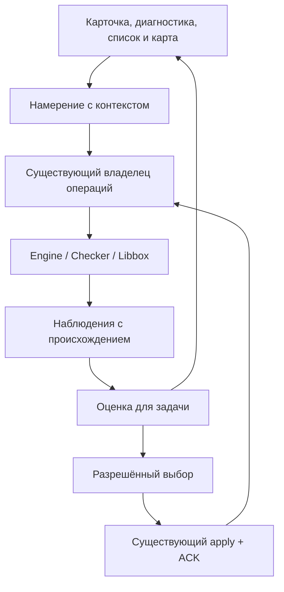

# Техническое ТЗ: измерения, контекст приложения, Atlas и непрерывность

**Статус:** `WAIT_OWNER_START`. Это проектирование, не команда менять код. **Основание:** [01-CODE-BASELINE.md](01-CODE-BASELINE.md), дерево `37421f5f5bffbea0391a39719ea7185923925897` / публичный `f66e5def3d689837db010c3453086a832c701fcc`. Перед реализацией обязательна сверка с новой работой соседнего исполнителя.

Названия типов и псевдокод ниже описывают контракт. Они не требуют новых runtime-файлов с такими именами и не являются готовой реализацией. Числа, помеченные `PROPOSED`, — стартовые ограничения или цели эксперимента, не измеренная скорость приложения. Внешние основы и лицензии — [03-OPEN-SOURCE-REUSE.md](03-OPEN-SOURCE-REUSE.md), интерфейс — [02-UX-INTEGRATION.md](02-UX-INTEGRATION.md).

## 1. Результат, который должен получить пользователь

Waarp сравнивает **разрешённые пути для конкретной задачи**, объясняет наблюдение, даёт одну понятную рекомендацию и применяет её через существующий владелец маршрутизации. Карта использует те же подключения и измерения. Улучшение пути старается не мешать текущей работе; отзыв пути, главный OFF и явная строгая политика действуют сразу.

В ближайший результат не входит собственный новый сетевой стек. HTTP/TCP/UDP — разные объекты измерения. Выбор транспорта туннеля не превращает приложение, работающее по TCP, в UDP-приложение. Поддержка UDP у профиля, успешный STUN и живой UDP-сеанс конкретной игры — три разных уровня доказательства.

### Обязательные инварианты

| ID | Контракт |
|---|---|
| I-01 | Главный пользовательский OFF старше любой проверки, рекомендации, delayed callback, auto-switch и restart recovery. Поздняя операция не включает VPN |
| I-02 | На платформе остаётся один владелец lifecycle и один владелец выбора маршрутов. Карта, карточка и диагностика подают намерения, а не управляют core самостоятельно |
| I-03 | Сохранено / подготовлено / применено / подтверждено / текущие сессии ещё на старом пути — разные состояния |
| I-04 | Результат принадлежит сети, поколению native session, конфигурации пути, scope и цели. Изменение любого существенного поля делает доказательство непригодным для apply |
| I-05 | Просмотр, фильтрация, открытие карты и сравнение не меняют маршруты. Автоматический выбор возможен только в явно включённом пользователем режиме и его разрешённом scope |
| I-06 | Публичный каталог не входит автоматически в личный Auto. Недоступный выбранный путь не разрешает скрытый Direct |
| I-07 | Отсутствие измерения, отмена, неподдержанная возможность, stale и отсутствие телеметрии не становятся нулевой задержкой, успехом или сетевой ошибкой |
| I-08 | Мягкая оптимизация не обрывает здоровую сессию ради небольшого перевеса. Строгий запрет/отзыв не сохраняет запрещённую сессию ради красивой статистики непрерывности |
| I-09 | Новые состояния помещаются в существующие карточки, выбор сервера, диагностику и журналы. Никакой обязательной новой панели инженерных параметров |
| I-10 | Любая заявленная возможность проходит цепочку: upstream source → доступность в фактическом binary/AAR → корректная привязка к пути → полезный трафик в описанном опыте |

## 2. Владельцы и направление данных



Windows: runtime-решения остаются в `Engine`/существующем main orchestration; `createApply` — единственная дорожка пользовательской записи маршрута, `Checker` сохраняет lease и cleanup. Android: `MobileRepository` владеет данными, probe/edit и выбором; `VpnController`/service владеют lifecycle, `LibboxBackend` — native API. `MobileViewModel`/renderer держат представление операции, а не фоновый алгоритм Auto.

Общий «сервис измерений» означает единый контракт и арбитраж уже имеющихся операций, а не второй постоянный процесс. На первых шагах достаточно адаптеров вокруг `diagnose`, health, `probe`, payload, tuning и catalog verify. Их постепенное согласование с одним owner предпочтительнее большой одновременной переписи. Существующие расписания и их границы описаны в [базе](01-CODE-BASELINE.md#2-опорные-места-в-коде).

Измерение создаёт evidence. Оценка объясняет, подходит ли evidence задаче. Решение проверяет допустимость выбора. Применение выполняет транзакцию и ждёт native ACK. Ни классификатор, ни карта не имеют метода «перезапусти core».

## 3. Контракты данных

### 3.1. Контекст, путь и область действия

```ts
// Псевдотипы документа; реализация использует текущие ID и validators.
type Epoch = {
  ownerIntent: number;       // главный ON/OFF и новая пользовательская операция
  nativeSession: string;    // Windows child/session, Android generation
  network: string;          // локальная эпоха физической сети; unknown не общий bucket
  configRevision: number;
};

type PathRef = {
  profileId: string;
  generation: string;       // конкретное неизменяемое определение/worker
  configDigest: string;     // локальный непрозрачный digest, не ключ или outbound JSON
  trust: 'personal' | 'public';
};

type RouteScope =
  | { kind: 'route'; routeId: string; matchRevision: string }
  | { kind: 'app'; existingRouteId: string; appIdentity: string; matchRevision: string }
  | { kind: 'host'; canonicalHost: string; matchRevision: string }
  | { kind: 'global'; policyRevision: string };

type ProbeTarget = {
  id: string;               // локальная ссылка; endpoint не копируется в общий отчёт
  role: 'control' | 'application' | 'cooperating-udp' | 'user-upload';
  protocol: 'dns' | 'tcp' | 'tls' | 'http' | 'udp';
  endpointRef: string;
};
```

`PathRef.generation` нужен потому, что имя/ID профиля может сохраниться при изменении credentials или endpoint. Старый flow не должен внезапно получить новое определение того же ID. Digest и полная конфигурация остаются локальными; из публичного digest нельзя обещать анонимность. `appIdentity` использует существующую нормализацию process path/package/UID; данные native `SetPackageName`/`SetProcessPath` — вход симуляции routing, не доказательство наблюдаемой сессии приложения.

Эпоха сети и долговременный salted fingerprint — разные вещи. Первая инвалидирует оперативное решение, второй помогает локальному cache. Если fingerprint недоступен, текущая проверка возможна с ephemeral epoch, но перенос исторического успеха между неизвестными сетями запрещён. Монотонное время использовать для deadlines/срока текущей операции; wall clock — для подписанного времени отображения и уже существующего долговременного cache.

### 3.2. Наблюдение

```ts
type Observation = {
  id: string;
  operationId: string;
  epoch: Epoch;
  path: PathRef | { kind: 'direct'; binding: 'physical-network' };
  scope: RouteScope;
  target: ProbeTarget;
  method: 'http-control' | 'http-target' | 'dns-stage' | 'tcp-connect'
        | 'tls-handshake' | 'payload-integrity' | 'udp-echo'
        | 'stun-binding' | 'network-quality' | 'passive-flow';
  binding: 'verified-outbound' | 'verified-physical' | 'unverified';
  result: 'ok' | 'failed' | 'timeout' | 'cancelled' | 'stale'
        | 'unsupported' | 'not-measured';
  metric?: { kind: string; unit: 'ms' | 'bytes' | 'ratio' | 'rpm';
             value: number; samples: number; windowMs: number };
  beganAt: number;
  elapsedMs: number;
  expiresAt: number;
  reason?: string;          // allowlisted code; сырой native текст отдельно очищается
  source: { adapter: string; coreVersion: string; capability: string };
};
```

Не смешивать `http-control` с ICMP до адреса сервера и не подписывать любую миллисекунду просто «ping». Например, desktop OFF fallback может получить endpoint ICMP для отображения; это не тот же health-вердикт. Для latency display хранить метод. Для метрики jitter хранить определённую методику и число пакетов, для loss — ожидаемые/полученные пробы; нескольких HTTP-запросов для UDP loss недостаточно.

`binding=unverified` допускает исследовательский отчёт, но не улучшает рейтинг конкретного пути. `failed` означает неудачу конкретного теста к конкретной цели, не «вся сеть не работает». Различающиеся DNS-ответы не доказывают подмену; провал всех проверенных путей не доказывает глобальную недоступность сервиса.

### 3.3. Оценка и предложение

```ts
type AppPurpose = 'balanced' | 'interactive' | 'voice' | 'transfer';
type ContinuityPreference = 'hold-app-session' | 'new-flows-when-safe';

type RouteAssessment = {
  scope: RouteScope;
  purpose: AppPurpose;
  path: PathRef;
  suitability: 'supported' | 'limited-evidence' | 'unsuitable' | 'unknown';
  evidenceIds: string[];
  missing: string[];        // например udp-service или payload-upload
  reasons: string[];        // короткие проверяемые основания, не выдуманный 98/100
};

type RouteProposal = {
  id: string;               // выдаёт доверенный owner, renderer не подписывает proof
  epoch: Epoch;
  scope: RouteScope;
  previousPolicyDigest: string;
  nextPath: PathRef;
  eligibleSetDigest: string;
  assessment: RouteAssessment;
  effect: 'soft-preference' | 'strict-policy' | 'failed-path-recovery';
  continuity: ContinuityPreference;
  expiresAt: number;
};
```

Внутренний числовой ранжирующий алгоритм допустим, если он воспроизводим, сравнивает одинаковые методы и не скрывает отсутствующие данные. В первом UI показываются пригодность, свежесть, главное основание и недостающий факт. Не публиковать универсальный «балл сети», не сравнивать HTTP к разным контрольным хостам как измеренную игровую задержку.

Перед apply повторно проверяются owner intent, native session, network epoch, ревизия scope, предыдущая политика, identity каждого профиля, allowed set и TTL. Старый успешный результат остаётся видимым с отметкой устаревания, но его кнопка применения не действует. Для первой реализации использовать существующие proof-подходы Windows и tuning; Android выровнять контракт без копирования двух независимых механизмов.

## 4. Одна очередь измерений

### 4.1. Уровни глубины

| Уровень | Что используется | Когда запускается | Чего не утверждает |
|---|---|---|---|
| A: существующее наблюдение | Health, выбранный путь, активные flows, счётчики/ошибки native | Действующий runtime loop | Счётчик байтов не доказывает полезную передачу; поток UDP не даёт loss |
| B: дешёвая проверка | Текущий HTTP control и запрос к разрешённой цели | Явный подбор/диагностика; bounded Auto в своём cadence | Контрольный HTTP не доказывает пригодность игре |
| C: уровни соединения | DNS/dial/TLS/HTTP с проверенной привязкой к пути | Уточнение причины, когда данных B недостаточно | Стадия «UDP route selected» не доказывает обмен с UDP-сервисом |
| D: полезная передача | Существующий payload check, optional upload; проверенный controlled UDP test | Явная глубокая проверка, понятная стоимость | Это результат к измерительному endpoint, не SLA любого приложения |
| E: под нагрузкой | Upstream networkquality/RPM при подтверждённом route binding | Отдельная явная операция после capability gate | Не запускать в фоне, во время игры или на metered сети по умолчанию |

Кандидаты повторного использования: upstream `StartConnectionTest` для staged диагностики; networkquality для idle/loaded responsiveness; STUN для NAT-related факта. Standalone native helpers с default dialer не удовлетворяют `verified-outbound`. У desktop есть другие поверхности CLI/API, у Android — другие JNI exports. Их фактическая доступность устанавливается спайком, а не названием файла в репозитории. Подробности: [03-OPEN-SOURCE-REUSE.md](03-OPEN-SOURCE-REUSE.md).

### 4.2. Бюджеты, совместное использование и отмена

| Ограничение | Проектное решение |
|---|---|
| Один foreground owner | Диагностика/подбор/payload/tuning используют существующий lease/mutex; новая UI-поверхность не создаёт параллельный checker |
| Приоритет | OFF/revoke → control/apply → health текущего пути → явная проверка → фоновые challengers/catalog. Длительная низкоприоритетная работа уступает, не блокирует остановку |
| Кандидаты | Сохранить общий cap 8 на раунд; переиспользовать results и совпадающие запросы. Это cap на owner, не 8 × количество карточек |
| Новые foreground targets | `PROPOSED`: до 2 целей и до 2 одновременно исполняемых лёгких проб в первом app-specific проходе; выбирать целевой endpoint и один control |
| Deadline | Сохранить desktop 20 секунд для обычной диагностики; `PROPOSED`: такой же верхний бюджет нового краткого сценария Android. Глубокая payload/tuning — существующая отдельная операция до 60 секунд |
| Heavy work | Нет фонового throughput, непрерывного STUN/UDP flood, полного каталожного scan или DNS-разрешения всех точек карты |
| Metered/background | Карта читает cache; foreground deep test показывает ожидаемый вид передачи. После сворачивания не появляется новый бесконечный job |
| Cache | Reachability не дольше существующих 5 минут и только в той же эпохе/конфигурации. `PROPOSED`: точный quality assessment устаревает через 60 секунд; агрегат истории не становится apply proof |
| Возврат/отмена | Закрыть свои sockets/command client, дождаться cleanup до освобождения lease. Отмена не ухудшает health, не завершает соседний запрос и не меняет маршрут |
| История | В оперативном snapshot только последние нужные значения; LastSessionEvidence сохраняет уже действующие 48 событий / 64 КиБ. Подробные истории по умолчанию не расширять |

Существующий health loop нельзя полностью заморозить большим сравнением: он обслуживает failover и наблюдение основного пути. Конкретный arbiter должен позволять кооперативную уступку между пробами. Если текущий backend не умеет безопасно прервать отдельный запрос без общего stop, такая операция отклоняется или выполняется после освобождения ресурса; она не становится второй native session.

При соединении одинаковых запросов subscriber cancellation отделяется от owner cancellation: закрытие карты снимает её подписку, но не отменяет health, который использует то же наблюдение. OFF/revoke отменяет общий запрос и всех подписчиков.

## 5. Приложение, правила и Auto

### 5.1. Небольшие профили поведения

Профиль — дополнение существующего preset/route, а не импорт чужой полной конфигурации. Минимальный состав: существующие matcher IDs, цель `balanced/interactive/voice/transfer`, разрешённые типы теста, continuity preference и версия набора правил. Не добавлять исполняемые плагины, скрипты, поля «вставьте любой YAML» или десятки транспортных крутилок.

| Назначение | Что имеет смысл оценить | Что показывать при недостатке данных |
|---|---|---|
| По умолчанию | Работоспособность текущего пути, контролируемый HTTP, наблюдаемая передача | «Путь отвечает; качество для этого приложения не измерено» |
| Интерактивное | Стабильность текущего сеанса; RTT/jitter/loss только при валидном UDP endpoint или подходящем app protocol | «HTTP доступен; UDP этой игры не проверен» |
| Голос | Непрерывность, двусторонний обмен, variation/loss в подходящем тесте | «Соединение установлено; качество звонка пока неизвестно» |
| Передача | Существующий payload integrity, optional upload, явный тест под нагрузкой | «Проверена небольшая передача; устойчивая скорость не измерена» |

Профиль не должен заявлять поддержку игры на основании заранее придуманного списка доменов. Для приложения без проверенной схемы — balanced и ручной выбор назначения. Из native metadata можно предложить контекст уже наблюдаемого процесса; нельзя расшифровывать TLS, повторять пользовательские авторизованные запросы или делать вывод о логине из обычного HTTPS-control.

### 5.2. Scoped selection вместо влияния на общий Auto

Сначала реализуется рекомендация в контексте существующей карточки. Apply меняет эту карточку через её selector/маршрут. Если она ссылается на общий `g-auto`, решение не должно менять глобальный `grp-g-auto` ради единственной цели. Предпочтительный кандидат реализации — ограниченный runtime overlay выбора у карточки поверх общего набора личных профилей; профиль и его credentials не дублируются. Сохранённый смысл «Auto» остаётся узнаваемым.

Scope должен учитывать фактическое первое совпавшее правило, порядок app/domain/default, bypass и DNS-политику. Измерение домена в контексте процесса не даёт права создать глобальное доменное исключение. Результат «этот хост работает через B» и изменение «всё приложение через B» имеют разный охват; UI показывает именно предлагаемое изменение.

Автоматический режим на уровне приложения включается только после подтверждения scoped selectors на обеих платформах. До этого доступна явная рекомендация с применением через существующую карточку. Отсутствие runtime-слота не ведёт к созданию нового persisted профиля или скрытому global selection.

Политика выбора сначала фильтрует допустимые пути, затем проверяет совпадение сети/цели/метода, затем оценивает пригодность, затем применяет hysteresis. Unknown не выигрывает у работающего пути. Подтверждённый failed path может уступить проверенному резерву; здоровый путь меняется только при доказанном полезном перевесе и совместимой continuity policy. Существующие ограничения anti-flap сохраняются до отдельной обоснованной корректировки.

## 6. Контур непрерывности

### 6.1. Классы изменений

| Класс | Примеры | Действие над текущими сессиями |
|---|---|---|
| Метаданные | Переименование, фильтр карты, порядок отображения | Никакого dataplane action |
| Мягкое улучшение в той же разрешённой политике | Подтверждённо лучший личный путь в разрешённом Auto | По умолчанию удержать работающую app-session; при проверенной независимости новых flows разрешить новый выбор только им |
| Строгая смена политики | Отзыв/удаление разрешения, Block, явный Direct, переход из Direct в обязательный туннель, новый обязательный exit/страна/граница приватности | Запретить старый недопустимый путь и закрыть затронутые сессии; сохранение непрерывности не отменяет намерение пользователя |
| Подтверждённый отказ пути | Старый endpoint/физическая сеть недоступны | Переключить новые допустимые соединения, минимизировать восстановление; не обещать перенос уже потерянного TCP |
| Структурное изменение | Недоступный в текущем native graph профиль/настройка | Сохранить живую сессию и честно сообщить ограничение; Autopilot не превращает это в скрытый restart |

`soft-preference` — внутренне проверенный класс, не произвольный флаг renderer. Вручную выбранная пользователем строгая идентичность выхода не должна молча трактоваться как «когда-нибудь для будущих соединений». Обратное также важно: при мягкой оптимизации нельзя утверждать, что все старые соединения уже на новом пути. Формулировки состояний согласуются с [UX](02-UX-INTEGRATION.md).

Существующий явный ручной сценарий Android со `StructuralRestartApproval` сохраняется: при несовместимом native graph пользователь может согласовать временное прерывание либо отменить изменение. Новый Autopilot не обходит это согласие и не вызывает его в фоновом подборе. Проверить новый кандидат при ON и применить его к действующему TUN — разные capabilities.

Строгое удаление/revoke имеет приоритет даже если прежнее сохранение сессии обещало дождаться idle. Ошибка новой подготовки не разрешает оставить запрещённый старый путь; применяется scoped reject и понятная ошибка. Ограничение относится к затронутому scope, а не к всем приложениям.

### 6.2. Поток и сессия приложения

Одного pinning по 5-tuple недостаточно для всех приложений. Игра может держать TCP-логин, UDP-матч и периодически создавать HTTP-запросы. Если каждый новый flow сразу уходит через новый exit IP, приложение может потерять согласованность, хотя старые сокеты не закрывались. Поэтому первый безопасный default для неизвестной семантики — `hold-app-session`: удерживать общий путь для активного scope и связанных новых потоков до idle либо явного строгого действия.

Не пытаться автоматически распознавать любую игровую сессию. Использовать ограниченный cohort по существующему app scope и поколению policy. Для проверенного профиля можно разрешить `new-flows-when-safe`. В обоих режимах настоящий отзыв/запрет сильнее cohort pinning. При неизвестной/потерянной flow telemetry считать cohort потенциально активным, не освобождать его по пустому UI-списку.

```ts
type FlowLease = {
  flowId: string;
  scopeId: string;
  cohortId: string;
  policyGeneration: string;
  path: PathRef;
  state: 'active' | 'closing' | 'ended' | 'unknown';
};

type PathLifetime = {
  path: PathRef;
  selectedBy: string[];       // текущие route scopes
  activeCohorts: string[];
  leasedFlows: number | null; // null — telemetry unknown, не 0
  status: 'prepared' | 'selected' | 'draining' | 'revoked' | 'stopped';
};
```

Это модель lifetime, не обязательство получать идеальный payload-aware session ID. Возможность достоверно сопоставить flow с поколением late worker и native selector нужно подтвердить. Если API выдаёт только изменяемое имя, сначала проверить адаптер/консервативное удержание, а не приписывать потоки новому серверу задним числом.

### 6.3. Транзакция применения

1. Захватить существующий edit/control owner и snapshot актуальной подтверждённой политики.
2. Проверить proposal и разрешённый scope; классифицировать изменение на доверенной стороне.
3. Подготовить новый путь в пределах текущего native graph/slots. Readiness процесса отдельно от HTTP/UDP evidence. Не закрывать прежний worker ради места до принятия решения.
4. Для soft preference подготовить lifetime/flow protection. Для strict policy установить scoped guard, блокирующий недопустимые новые потоки во время перехода.
5. Применить selectors/rule files по нынешнему механизму и дождаться проверяемого ACK. Изменение, требующее нового graph, возвращает capability/structural result.
6. Согласовать сохранённое намерение и runtime согласно существующей платформенной транзакции. Windows и Android сейчас имеют разный порядок persistence: новая логика не должна ломать их rollback.
7. Soft: существующие допустимые flows/cohorts остаются на старом `PathRef`; новый выбор становится доступен по continuity policy. Strict: точечно закрыть недопустимые старые flows и проверить закрытие/барьер.
8. Освободить guard только после подтверждения; опубликовать точное состояние UI. Retire старый worker только при отсутствии selected refs и подтверждённом завершении leases, либо немедленно при hard revoke.

При ошибке откатить именно подтверждённый прежний snapshot, а не случайный последний JSON. Если native state неизвестен, оставить scoped barrier и текущее предупреждение о неопределённости; не запускать глобальный restart как обработчик timeout. OFF инвалидирует операцию между любыми шагами. Основание — уже существующие `Engine.restoreLive`, `createApply`, `MobileRepository.edit` и `LiveRoutingFiles.apply`, перечисленные в [базе](01-CODE-BASELINE.md).

### 6.4. Старые workers и пределы ресурсов

Desktop `relays.trim` сегодня останавливает неиспользуемый worker сразу. Для soft continuity его keep-set должен учитывать допустимые flows/cohorts, а не только ссылки актуальной конфигурации. `ensure` не может переиспользовать slot с активным поколением. Замена credentials того же profile ID требует новой generation или отказа live-изменения; старый процесс не получает новые секреты посреди действующей сессии.

Начальные пределы `PROPOSED`: сохранить общий лимит 16 late slots; не более 2 удерживаемых старых поколений на scope. Эти числа не добавляют 32 workers поверх нынешнего пула. При насыщении новая мягкая оптимизация откладывается/отклоняется, действующая работа сохраняется. Принудительное закрытие здоровых потоков ради очередного сравнения запрещено. Нельзя удерживать неограниченное число поколений или хранить один и тот же revoked profile под новым названием.

У долгой загрузки drain может длиться долго. Потребление памяти/процессов остаётся ограниченным cap; новые мягкие смены ждут. Не вводить скрытый короткий timeout, после которого «бесшовность» заканчивается принудительным обрывом. При необходимости пользовательский способ явно завершить старые соединения размещается в существующих подробностях; это не обязательный шаг каждого выбора сервера.

На Android нет готового аналога Windows late SOCKS pool. Сначала проверить живую смену между уже загруженными профилями и нативное удержание sessions; перенос desktop-схемы с несколькими процессами на телефон без анализа запрещён. Если структурное late load не укладывается в фактический API, первая версия continuity имеет честно меньший охват, а проект не обещает one-click parity.

### 6.5. Что считать успешной непрерывностью

| Сценарий | Обязательный результат |
|---|---|
| Soft switch при активном допустимом TCP download | Не сброшен старый TCP, данные завершаются; новый маршрут отражён честно, соседние потоки не затронуты |
| Игровой UDP + TCP login + новые HTTP-запросы | Cohort policy не создаёт неожиданную смену exit identity между каналами; при unknown используется hold |
| Возврат с fallback на оживший primary | Нет необязательного обрыва текущего healthy cohort; отмена активной охраны отдельно обоснована |
| Отзыв активного профиля во время drain | Новые/старые запрещённые сессии прекращены; никакой скрытой отсрочки revoke |
| Explicit Direct/Block или обязательная смена exit | Реальная политика совпадает с пользовательским намерением; старый tunnel не остаётся скрыто обслуживать запрещённый scope |
| Потеря control stream | Действующий TUN не перезапущен ради телеметрии; unknown flows не считаются idle |
| Физический Wi-Fi→cellular / смена адреса | Отдельный измеренный recovery outcome; отсутствие универсального TCP handover не маскируется сохранением PID |
| OFF во время prepare/ACK/drain | Все новые действия отменены, принадлежащие операции ресурсы убраны; delayed callback не включает VPN |

## 7. Atlas как проекция текущих данных

```ts
type GeoHint = {
  precision: 'country' | 'region' | 'approximate-point' | 'unknown';
  source: 'profile-label' | 'user' | 'local-dataset' | 'provider';
  country?: string;
  point?: { lat: number; lon: number; uncertaintyKm?: number };
  observedAt?: number;
};

type AtlasSnapshot = {
  revision: string;
  epoch: Epoch;
  scope: RouteScope;
  view: { filter: string; page: number; previewId?: string };
  routing: {
    pendingSelection?: { proposalId: string; path: PathRef };
    confirmedActivePath?: PathRef;
    drainingPaths: PathRef[];
  };
  nodes: Array<{ id: string; profileRef?: string; kind: 'self' | 'personal' | 'public';
                 geo: GeoHint; observationIds: string[];
                 health: 'available' | 'failed' | 'unknown';
                 freshness: 'fresh' | 'stale' | 'unmeasured' }>;
  edges: Array<{ id: string; from: string; to: string;
                 meaning: 'logical-selection' | 'checked-path';
                 observationIds: string[]; activeCohort?: boolean }>;
};
```

Snapshot строится из текущей библиотеки, `CatalogPool`/`PublicCatalog`, эффективных route selections и общего evidence store. Карта не имеет отдельного каталога, сканера, авторитета выбора или собственного health. Фильтры и `previewId` общие со списком; возврат сохраняет страницу/позицию. Просмотр точки меняет только preview. Для указанного scope ожидающее применение, активный путь с подтверждённым native ACK и пути ещё работающих старых сессий хранятся отдельно в `routing`; отсутствие подтверждения не заполняется просматриваемой точкой. Здоровье и свежесть измерений узла не зависят от того, просматривается ли он, ожидает применения или обслуживает текущую сессию. Snapshot/redaction не содержит credentials, необработанные конфиги и server URLs, не нужные представлению.

Country, извлечённая из имени подключения, показывается как подсказка с источником, а не подтверждённая геолокация. Центр страны не выдаётся за адрес дата-центра. Неизвестные точки остаются доступными в списке/соответствующей группе. «Рядом» означает только известную географическую близость с учётом точности геоданных. При отсутствии таких данных подбор по измерениям называется «Подходящие по проверке» или «Рекомендуемые»; задержка не подменяет расстояние. Линия — логическая связь выбора, не доказанный физический маршрут пакетов. Без отдельного измерения/источника нет «загрузки сервера» и цветовой тепловой карты загруженности.

В ближайшем Atlas пригодна локальная схематичная карта с проверенной лицензией данных и lazy rendering. GPS и обязательный внешний GeoIP/tiles endpoint не требуются для запуска. Внешние данные, если позже нужны, проходят текущую политику служебных загрузок и её ограничения TLS/redirect/Direct. Недоступность карты не отключает список. Подробный data/privacy/community план — [06-ATLAS-DATA-COMMUNITY.md](06-ATLAS-DATA-COMMUNITY.md).

Карта сообщества — отдельный opt-in контур. Локальная модель должна позволять добавить aggregate overlay, но текущая реализация не экспортирует app destinations, персональные профили, ключи, SSID/gateway, fingerprint сети или точные координаты. Хеш стабильного идентификатора сам по себе не делает его анонимным. Наблюдение другого человека — подсказка для локальной проверки, не ready/verdict текущего подключения.

## 8. Миграция и совместимость

Сначала добавить необязательные поля с `schema`/версией в локальный measurement/assessment слой. Отсутствие app purpose означает balanced. Существующие route/profile IDs, секреты, порядок правил, выбранные defaults и пользовательское ON/OFF не изменяются при обновлении. `g-auto` не пересохраняется в сотни новых групп. Исходные presets/rules остаются читаемыми; несовместимый скачанный набор не применяется частично.

Оперативные leases, epochs и proposal tokens не переживают restart как разрешение продолжить apply. Персистентный cache после старта получает stale/исторический статус до проверки сети и профиля. Старый display latency без известного метода маркируется legacy/unknown и не получает задним числом смысл UDP RTT. Удаление истории инвалидирует отложенные записи так же, как текущий evidence owner.

Новые поля оценки не участвуют в структурной native signature, пока действительно не меняют routing. Изменение purpose или фильтра карты не должно само вызывать TUN restart. Если scoped Auto требует дополнительных native selectors, capacity планируется в отдельном gate; отсутствие места сохраняет прежний routing и выводит ограничение.

Rollback новой функции отключает новые рекомендации/представление, оставляя существующие карточки и конфигурацию действительными. После реального пользовательского apply нельзя восстанавливать старый route скрытым выключением feature flag. Решение об откате такой политики проходит обычный owner и актуальное намерение пользователя.

## 9. Метрики и цели экспериментов

Измерять раздельно: `detection_latency` (от наблюдаемого отказа), `prepare_duration`, `native_commit_duration`, `first_success_new_flow`, `max_gap_existing_flow`, `application_recovery`, `unrelated_disconnects`, `tun_restarts`, `bytes_probed`, `old_workers_retained`, `stale_results_rejected`. Между failure detection каждые 15 секунд и локальной записью selector в несколько миллисекунд нет эквивалентности.

| Критерий | Начальная цель/правило |
|---|---|
| Необязательные обрывы | 0 в контролируемых healthy soft-switch fixtures; это gate корректности, не обещание отсутствия потерь в интернете |
| Соседние приложения | 0 закрытий незатронутых соединений при применении scoped изменения |
| TUN | 0 перезапусков от просмотра/проверки/обычного совместимого soft apply |
| Strict policy | 0 подтверждённых потоков по запрещённому старому пути после успешно подтверждённого запрета; неопределённость остаётся blocked/uncertain |
| UI | `PROPOSED`: p95 до 100 мс от ввода до видимого принятия/отмены операции в reference UI harness; сеть не задерживает отклик кнопки |
| Существующие потоки | `PROPOSED`: стремиться к baseline + 50 мс для gap при мягкой правке в controlled fixture, без resets; смотреть распределение и throughput, а не только факт «socket не закрыт» |
| Новое соединение после смены | Измерить first-success/TTFB отдельно от старого flow и cold prepare; не выдавать время native ACK за время прикладного восстановления |
| Холодный/отказавший путь | Публиковать измеренные prepare/recovery и причину, не обещать микросекунды; timeout не считается фактической latency |
| Цена функции | В отчёте CPU/memory/handles/battery proxy, probe bytes и wakeups с функцией/без неё; bounded pool подтверждён кодом и наблюдением |

Новая лабораторная цель не меняет текущий timeout native ACK в исходниках. Пока baseline не снят, значения выше не объявляются SLO выпуска и не попадают в маркетинг. Для Windows и Android нужны отдельные результаты на фактических core pins; число «переключение за N мс» должно описывать конкретную измеряемую стадию.

## 10. Узкие feasibility gates до основной разработки

Каждый эксперимент — отдельная ограниченная задача после команды владельца, с документом «способ → наблюдение → граница → решение». Не создавать одновременно несколько новых подсистем ради проверки одной гипотезы.

| Gate | Вопрос и место интеграции | Минимальная проверка и выход |
|---|---|---|
| G-01: selector semantics | Оба exact pins; native selector + текущий apply | Контролируемые TCP, UDP, DNS и соседний поток; true/false, internal/external, warm selection; сохранить/закрыть по классу. Выход: допустимый класс continuity для каждой платформы |
| G-02: worker lifetime | `Engine.closeTouched`, `LiveOutbounds.ensure/trim`, flow attribution | A→B→C, длинный flow, один profile ID с новым config, заполнение всех slots, telemetry loss, revoke, OFF. Выход: ref model и cap либо отказ от мягкого late-path drain |
| G-03: app scope/cohort | Карточный selector, общий g-auto, Android live signature | Две карточки Auto с разными целями + TCP login/UDP game/new HTTP; одна рекомендация не меняет другую. Выход: overlay без размножения профилей или явный recommendation-only этап |
| G-04: staged native probe | Android `CommandClient.StartConnectionTest`, daemon route selection; desktop exact API/CLI | Проверить AAR export/build, cancellation, outbound binding, stage meanings; тест UDP route не выдаётся за service success. Выход: адаптер capabilities или unsupported |
| G-05: quality/STUN | Pinned networkquality/STUN, выбранный путь | Независимый controlled endpoint различает Direct/A/B, лимит байтов/времени, отмена и запрет фона. Выход: подходящий API; standalone default dialer не проходит gate |
| G-06: Android late outbound | `MobileLiveRouting`/Libbox, действующий graph | Новый путь при живом TUN без второго VPN, безопасное удаление/отзыв, лимиты ресурсов; никаких скрытых reload. Выход: подтверждённая возможность либо ограниченный UI с честным capability |
| G-07: Atlas projection | Catalog snapshot, GeoHint, список/карта | Offline, unknown geo, 10k desktop / 2k mobile dataset, stale, keyboard/font scale, переключение view без scan/apply. Выход: выбранный renderer/data bundle с лицензией и бюджетом |

G-04/G-05 проверяют reuse перед любым написанием собственного измерителя. Если существующий API не даёт нужной привязки, сначала рассмотреть небольшой upstream/downstream адаптер с понятным контрактом. Отсутствие API не разрешает заменить проверку данными default network и выдать их за конкретный туннель.

Это техническая детализация единой очереди [05-PLAN-AND-ACCEPTANCE.md](05-PLAN-AND-ACCEPTANCE.md), не второй backlog. G-01 соответствует CAP-02/OSS-S3; G-02 — CAP-03/OSS-S3; G-04 — CAP-01/OSS-S1; UDP-часть G-05 — CAP-05/OSS-S6, NetworkQuality — OSS-S2; G-07 — CAP-06/07/OSS-S4. G-03 закрывается в WN-02/04 и дополняет OSS-S5. G-06 использует результат CAP-04, но отдельно проверяет live apply: успешное измерение Android public candidate при ON не доказывает возможность добавить native definition без restart. Последовательность работы: WN-00 → необходимые CAP/OSS gates в WN-01 → соответствующее вертикальное изменение WN-02…06.

## 11. Ошибки и ожидаемое поведение

| Событие | Runtime | Что видит пользователь |
|---|---|---|
| Профиль отозван/изменён после результата | Proposal invalid; revoke закрывает запрещённый lifetime | Результат устарел; новый корректный шаг, без скрытого сохранения старого пути |
| Сеть сменилась во время проверки | Отмена/пометка stale, очистка применимости, предыдущие данные только как история | «Сеть изменилась; проверим в новой сети» |
| Пользователь закрыл диагностику | Отписка/отмена принадлежащей операции, cleanup до lease release | Старый маршрут остаётся; поздний результат не применяется |
| Достигнут pool/watchers/capacity | Отказ подготовки до destructive шага; текущая сессия сохранена | Короткое объяснение ограничения без автоматического restart |
| Новый путь не отвечает | Старый допустимый healthy path остаётся; evidence сохраняет точную цель/причину | «Этот путь не подтвердился», а не «интернет отключён» |
| Native ACK потерян | Существующий rollback/reconciliation; affected barrier при uncertainty | Состояние изменения не подтверждено; не показывать зелёный успех |
| Сохранение на диск не удалось | Платформенный rollback/честный saved≠applied | Ошибка сохранения и фактический выбранный путь, без ложной фиксации |
| Flow telemetry пропала | Cohort busy/unknown, optional switch отложен | Небольшой текущий статус, без ещё одного окна |
| Geo/тайлы недоступны | Локальный snapshot и список доступны | Unknown/ограниченная карта, выбор сервера остаётся рабочим |
| Все проверенные цели не ответили | Только вывод об этой выборке | Наблюдение и следующий диагностический шаг; нет заявления о полной блокировке |

## 12. Критерий готовности реализации

Сначала завершаются необходимые gates и небольшой вертикальный сценарий «карточка → существующая диагностика → оценка → актуальное scoped предложение → текущий apply». Затем подключаются более глубокие метрики и мягкая continuity там, где доказана возможность. Atlas получает тот же snapshot и не создаёт отдельное поведение. Обязательные UX-проверки идут вместе с каждым вертикальным изменением, а не после готовности сетевого кода.

Приёмка расширяет существующие focused tests: lifecycle/OFF, stale proofs, route priority/DNS, selector ACK/rollback, no unrelated disconnects, bounded resources и нативные TCP/UDP fixtures. Проверки не должны лишь повторять поля реализации. Нужны наблюдаемые инварианты: какой endpoint получил новый/старый поток, что произошло с соседним приложением и когда применение действительно стало фактом.

Сейчас ни один gate не отмечен выполненным, новые measurements отсутствуют. План выполнения и владелец старта — [05-PLAN-AND-ACCEPTANCE.md](05-PLAN-AND-ACCEPTANCE.md) и [07-HANDOFF.md](07-HANDOFF.md). Выполненная подготовка не разрешает начать эти эксперименты до отдельной команды пользователя.
