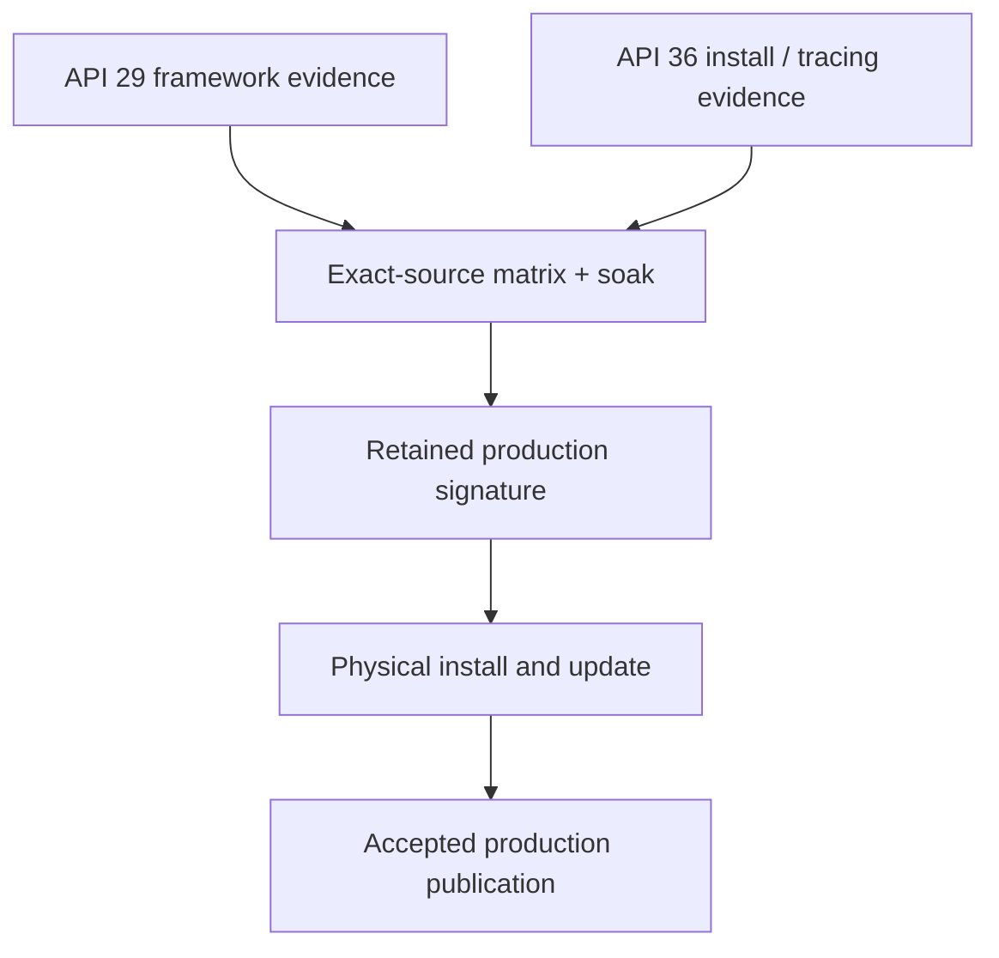

# Waarp: production roadmap и карта задач для агентов

**Цель:** удобный локальный выбор пути `приложение/домен → Direct / Auto / личное подключение` на Windows и Android. Сначала доказанная надёжность и понятное управление; затем дальнейшее развитие интерфейса, языков, размера поставки, Android «липучки» и распространения. Уже работающие возможности сохраняются.

**Аудит:** 21 ноября 2026; первоначальный SHA `63fc7930abfeac1b870e9c8e3fabc500768f419e`. **Сверка 22 ноября:** main `b3498c2bceab4c38c922bded7e6fc518f30833e7` после merged PR #46–51. [Общий CI 45055812462/1](https://github.com/INNVoices/waarp/actions/runs/45055812462) успешен; [preview r2](https://github.com/INNVoices/waarp/releases/tag/preview-2026-11-22-r2) опубликован из этого source в 18:50:34 UTC после успешного [release run 45055812375/1](https://github.com/INNVoices/waarp/actions/runs/45055812375). Отдельная [полная Android matrix](https://github.com/INNVoices/waarp/actions/runs/45055812356) завершена 6 success / 1 failure / 1 skipped; production gates остаются. Это snapshot; перед новой задачей проверить текущий HEAD. [Parent issue #32](https://github.com/INNVoices/waarp/issues/32). Карта содержит **8 корпусов и 60 задач**.

## Начать работу

```sh
python3 scripts/production-roadmap.py check
python3 scripts/production-roadmap.py ready
python3 scripts/production-roadmap.py ready --lane ui-localization
python3 scripts/production-roadmap.py show STK-003
```

Команды ничего не меняют и не отправляют в сеть. Перед выбором задачи проверить свежий main, связанный issue/PR и ownership. Полное ТЗ находится по ссылке из [tasks.json](tasks.json); `ready` выводит только незанятые задачи без незакрытых жёстких зависимостей и известных внешних blockers. Условные production gates не блокируют подготовку честно обозначенных preview.

## Карта корпусов

| Корпус | Задачи | Результат | Рабочий issue |
| --- | --- | --- | --- |
| [01. Production и выпуск](01-production-release.md) | REL-001…009 | Связанные runtime evidence, точные пакеты, существующая подпись, установка/обновление и публикация | [#33](https://github.com/INNVoices/waarp/issues/33) |
| [02. Маршрутизация и безопасность](02-routing-and-security.md) | NET-001…006 | Смысл правил/DNS, live apply/rollback, protocol matrix, секреты, offline/revocation | [#34](https://github.com/INNVoices/waarp/issues/34) |
| [03. UI/UX](03-ui-ux.md) | UX-001…008 | Доступность, понятные состояния, фокус, крупный текст, onboarding, отсутствие потери черновиков | [#35](https://github.com/INNVoices/waarp/issues/35) |
| [04. Android «липучка»](04-sticky-companion.md) | STK-001…007 | Восстанавливаемый вход, conditional вызов по событию другого приложения, независимость от VPN | [#36](https://github.com/INNVoices/waarp/issues/36) |
| [05. Мультиязычность](05-localization.md) | L10N-001…008 | Развитие существующих 19 языков: выбор, fallback, placeholders, RTL, вычитка | [#37](https://github.com/INNVoices/waarp/issues/37) |
| [06. Сборка и зависимости](06-build-and-supply-chain.md) | BLD-001…006 | Измеренный состав EXE/APK, удаление дублей, сохранение runtime/лицензий, воспроизводимость | [#38](https://github.com/INNVoices/waarp/issues/38) |
| [07. Дистрибуция и рост](07-distribution-and-growth.md) | DIST-001…006, GROW-001…007 | Проверенная установка, package channels, полезный guide, допустимые submissions и измерение результата | [#39](https://github.com/INNVoices/waarp/issues/39) |
| [08. Работа агентов](08-agent-execution.md) | OPS-001…003 | Владение задачами, PR/CI, статусы и evidence, следующий ограниченный шаг | [#40](https://github.com/INNVoices/waarp/issues/40) |

Каждая карточка содержит priority, status, deps, файлы, изменение, критерии приёмки и способ проверки. Текст «проверить» означает конечный результат: таблицу, артефакт, test, patch или воспроизводимый blocker. Отсутствие evidence само по себе не доказывает дефект приложения.

## Очередность по целям

| Волна | Что делаем | Критерий выхода |
| --- | --- | --- |
| A. Снять production blockers | REL-001/002/003/009, NET-001/004, Windows REL-007; параллельно узкие UX-001 и L10N-001 | Причина каждого отказа классифицирована; проверки не ослаблены; конкретные UI-дефекты исправлены; нет выдуманного «зелёного Android» |
| B. Принять точный candidate | REL-004→005→006, NET-002, BLD-005, затем REL-008 | Один согласованный source/attempt, Android matrix и 7200 s soak, production identity, update/install evidence, Windows lifecycle, release-policy outcome |
| C. Сделать ежедневное использование проще | UX-003→004/005/006/007/008; L10N-002→003/004/005/006; BLD-001→002/003→004 | Понятны saved/applied/verified, формы и маршрут доступны, язык не ломает сессию, payload уменьшен с before/after evidence |
| D. Реализовать исходную «липучку» по проверяемым этапам | STK-001 ADR; STK-002 recovery/entry и STK-003 feasibility; затем observer STK-004 и acceptance STK-005/006 | Есть рабочий обратимый вход; cross-app поведение доказано только для заявленной матрицы; VPN/session не зависит от видимости UI |
| E. Расширять дистрибуцию на готовой основе | DIST + GROW, сохранять полезный onboarding и feedback loop | Manifest проверен настоящей установкой, опубликованный текст совпадает с binary, submissions разрешены и имеют receipts; рост не выдуман |

Это очередность решений, а не жёсткая последовательность всех работ. Read-only build inventory, тексты, locale checks и sticky feasibility могут идти, пока CI проверяет candidate. Важный P0 не ждёт косметической задачи; публикация production-файлов ждёт своих фактических gates. Сроки ставятся по доступности runtime/подписи/устройства и результатам проверки, без обещанных дат до их установления.

### Критический путь Android



Windows acceptance и routing/privacy gates проверяются отдельно и тоже входят в REL-008. Подпись не исправляет runtime, а успешный build не заменяет установку. Если retained key или physical environment недоступны, агент оформляет точный handoff и продолжает независимые ready задачи.

## Текущая волна и следующий шаг

| Задача | Состояние этого snapshot | Что делать дальше |
| --- | --- | --- |
| REL-002 / REL-009 | Конкретные causal fixes приняты в main через PR #42/#44; [API 29](evidence/2026-11-21-api29-accepted.json) и [SDK 20 / API 36](evidence/2026-11-21-api36-sdk20-accepted.json) records сохранены | Не выполнять эти исправления заново; включить согласованный код в будущий exact-main candidate. |
| REL-003 / REL-004 | [Новый exact-main b349 run 45055812356/1](https://github.com/INNVoices/waarp/actions/runs/45055812356): 6 success / 1 failure / 1 skipped; optimized API 36 отказал до app journey на `eventsEnabled=X`, 7 200 s soak skipped. Исторические [ec71](evidence/2026-11-21-ec71-acceptance-recheck.json) и [PR #48](evidence/2026-11-21-android-inventory-pr48.json) сохраняют свои отдельные причины | REL-003 остаётся in_progress, REL-004 blocked. Не объединять успешный preview API 35 с полной production acceptance; не повторять неизменённый job и не ослаблять guard. |
| REL-007 | [Published r2 record](../RELEASES.md#published-preview-2026-11-22-r2): EXE полностью скачан/SHA проверен; 3/3 launches за 52.078 s, 9/9 SVG, normal exits, профиль/settings/master OFF сохранены; отдельно native 50/50 за 303.942 s | Replacement проверен тем же candidate. UAC, different-version upgrade/rollback, standard-user и physical scenarios остаются открыты; REL-007 in_progress. Исторические PR #43/#47 records сохранены. |
| L10N-002 | `done`: [PR #46](https://github.com/INNVoices/waarp/pull/46) слит как 087a5ff; CI 44939689471 успешен. [19 negative mutations, 66 local suites и границы](evidence/2026-11-21-localization-contract-review.json) сохранены | L10N-003/004/006 готовы; L10N-008 ждёт L10N-006. Не выдавать static coverage за полный linguistic/visual/device review. |
| BLD-001 | `done`: [PR #47](https://github.com/INNVoices/waarp/pull/47) / [PR #48](https://github.com/INNVoices/waarp/pull/48) слиты как 210a219 / 4c384a8. [Baseline одного Windows и трёх APK](evidence/2026-11-21-package-baseline-ec71.json), Windows receipt и [6 Android inventory sidecars](evidence/2026-11-21-android-inventory-pr48.json) проверены в своей области | Продолжить BLD-002 и готовый BLD-003, сохраняя Android strict evidence replay и отдельный blocked production gate. |
| BLD-002 / BLD-004 | [Таблица 34 modules и Windows simple-icons slice](06-build-and-supply-chain.md): исторический PR47 EXE по CI меньше на **2 915 009 B (2.226780%)**, ASAR — на 16 865 911 B; 9 SVG и 3 portable запуска прошли; slice слит | Обе задачи остаются in_progress. Продолжить остальные Windows consumer slices и Android inventory/cleanup отдельно; весь корпус не закрыт. |

Исторические исходы, runtime-матрица и package baseline имеют собственные source/run identifiers. Их нельзя объединить в новый общий pass. Подтверждённые merges доставили свои ограниченные изменения; они не устанавливают production-подпись или полный runtime acceptance нового binary.

Текущий [preview 1.0.0 для Windows и Android](../RELEASES.md#published-preview-2026-11-22-r2) опубликован; все 12 assets анонимно скачаны целиком и проверены по bytes/SHA-256, оба manifests совпали с четырьмя бинарниками. Новые Android APK каждого ABI имеют другой сертификат, чем r5, и не обновляют его поверх установленного приложения. Windows unsigned / Android debug и успешный preview не меняют заблокированные stable REL gates.

## Историческое основание плана

- На исходном срезе 21 ноября `main` имел source version **1.0.0**, Android version code 7; публичными загрузками были **Windows r6 0.4.1-rc.5** и **Android r5 0.5.0-rc.5 debug**. Их исторические records сохранены отдельно от нового preview. Версия в исходниках не означает опубликованный stable binary. [Releases](../RELEASES.md).
- Общий CI baseline успешен; полный Android run `44831610512` не прошёл: build/native29/native35/release35 успешны, native36/release29/release36 неуспешны, soak skipped. Точный job ledger — в [корпусе 01](01-production-release.md). [CI](https://github.com/INNVoices/waarp/actions/runs/44831610512).
- **REL-001** слит через [PR #30](https://github.com/INNVoices/waarp/pull/30): ограниченные read-only observations после неудачного install. Локально прошли 10 новых и 32 существующих теста. Реальный collector сохранил ранние SurfaceFlinger crashes и отсутствие package/settings; [derived evidence](evidence/2026-11-21-pr30-install.json). Полное исправление причины этим не заявляется.
- **UX-001 / L10N-001** слиты через [PR #31](https://github.com/INNVoices/waarp/pull/31): два доступных имени кнопок и сообщение companion на актуальном языке. Typecheck, unit suite и browser UI step прошли в [Windows job PR31](https://github.com/INNVoices/waarp/actions/runs/44856670072/job/136700388158); все остальные обязательные этапы CI также успешны, PR слит.
- **GROW-001:** [руководство по первому маршруту](../guides/first-routes.md) подготовлено по исходникам публичных preview. Оно не заявляет новый device test.

Live статусы меняются через task registry и issues. Этот раздел сохраняет основание плана; новый успешный run добавляется как новое evidence, не стирая предыдущий отказ.

## Как сохранена первоначальная концепция

1. **Маршрут — понятное пользовательское намерение.** Direct, Auto, личный сервер и публичный источник не смешиваются. Исчезнувший/отозванный защищённый путь остаётся недоступным. Нет скрытого перехода в Direct/public fallback.
2. **UI не управляет VPN неявно.** Закрытие окна, смена языка, выбор черновика и launcher alias не подменяют ON/OFF или подтверждение применения.
3. **«Липучка» — Android-запрос.** [Оригинал](../ANDROID-CHAMELEON-2026-11-18.md) сохранён. Вызов из выбранного чужого приложения не требует его модификации; доступность события и launch path проверяются. Обычная tray/hotkey-функция Windows не засчитывается за этот результат.
4. **Чистка сохраняет возможности.** Удаляем измеренные дубли и ненужный payload; не выкидываем языки, notices или protocol support ради красивого размера.
5. **Продвижение ведёт к удачному первому опыту.** Guide, фактическая установка, точные ограничения и обратная связь предшествуют широким claims. Нет фальшивых stars, массовых повторов submissions или скрытой telemetry.

## Связь с предыдущими ТЗ

| Источник | Как используется сейчас |
| --- | --- |
| [TZ-NEXT](../TZ-NEXT-2026-11.md), [TZ-PROGRESS](../TZ-PROGRESS.md), этапы Э0–Э8 | Существующие проверки, Direct+DPI, tuning, protocol imports, lists/cache/catalogue сохраняются. Пробелы live evidence переходят в NET/REL; подробный crosswalk — корпус 02 |
| [WN planning](../planning/WAARP-NEXT-2026-11-18/README.md) и исторический task-status | Карты/atlas/UX и принятый прежний код не ставятся заново с нуля. Новый backlog уточняет дальнейшие gaps |
| [V1](../V1.md) | Источник code acceptance, package design, языков и ограничений. Не заменяет runtime acceptance текущего SHA |
| [Android Chameleon](../ANDROID-CHAMELEON-2026-11-18.md) | Прямое основание STK; ADR фиксирует первый recovery slice и отдельный cross-app spike |
| [Android handoff #25](https://github.com/INNVoices/waarp/issues/25) | Сохраняется открытым до доказанного production candidate; новый parent #32 не закрывает его |
| [Companion bridge](../BRIDGE.md) | Существующий локальный продуктовый API; не система координации агентов и не произвольная «липучка» |

Старые инструкции о private visibility, WAIT_OWNER_START или docs-only skip-CI трактуются в их историческом контексте. Текущие разрешение пользователя и protected-main checks определяют нынешний workflow.

## Следующие независимые назначения

Release agent продолжает ограниченное расследование REL-003 и отдельно закрывает ещё не проверенные Windows lifecycle сценарии. Routing/security agent может взять NET-001 или NET-004. UI/localization agent может брать готовые L10N-003/004/006 или независимые UX-002/003, согласовав общие runtime paths. Build agent продолжает BLD-002 либо берёт готовый BLD-003 по измеренной closure. Sticky agent может выполнить готовый bounded STK-003 spike. Distribution agent поддерживает фактические download links, guide и receipts. Координатор сохраняет историческое evidence и связывает новую публикацию с её exact-source record. Актуальные незанятые задачи печатает `ready`.

Завершение текущей сессии не создаёт бессрочную фоновую службу. Реально запущенные PR checks выполняются в GitHub; дальнейшие агенты получают эту карту, конкретные issues и сохранённые доказательства.
