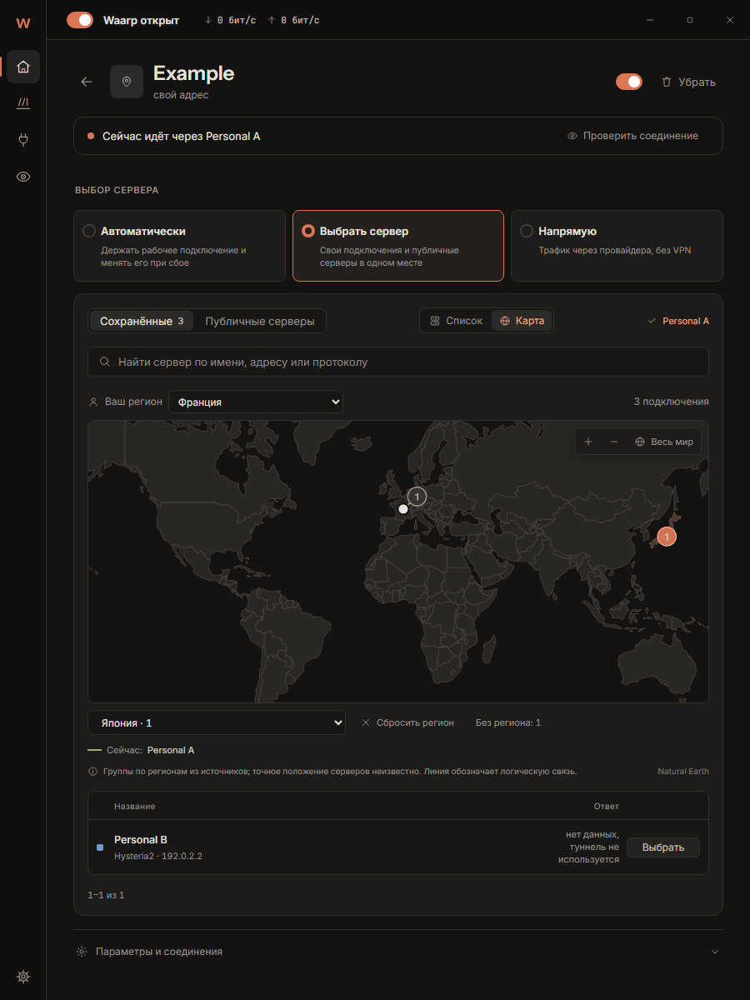
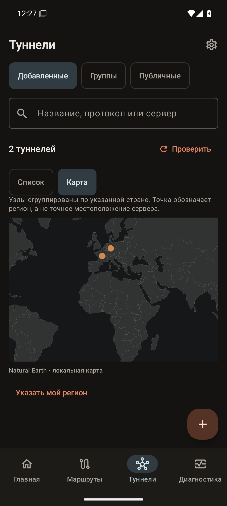

# Atlas и контекстная проверка: реальные кадры

Исходный код: [`230578139014639be497d10c30bd9da4d631cb28`](https://github.com/INNVoices/waarp/commit/230578139014639be497d10c30bd9da4d631cb28). Это кадры нового кода в main; опубликованный preview `r3` сделан раньше. Изображения скопированы из CI без перерисовки и монтажа.

## Windows

Собранный renderer запущен в Chromium с настоящим MapLibre WebGL и локальным worker. Профили, имена, измерения и состояние маршрутов задаются синтетическим IPC fixture. Кадры подтверждают UI и его компоновку; они не являются измерением реальных серверов.

UI-проверки [run 44300906714, attempt 1](https://github.com/INNVoices/waarp/actions/runs/44300906714/attempts/1) прошли. В том же задании позднее отказал отдельный lifecycle snapshot на 16-м цикле и доставка artifacts. Повторная native-приёмка того же SHA описывается отдельно в [отчёте интеграции](../../planning/WAARP-NEXT-2026-11-18/09-ACCEPTANCE.md); эти кадры не скрывают общий failure первого задания.

| Кадр | Что видно |
| --- | --- |
| [Выбор сервера, 900 px](windows-atlas-picker-900.png) | Текущий A сохраняется при просмотре японского B; вручную выбранный регион устройства, фильтр и явная кнопка выбора |
| [Выбор сервера, 1240 px](windows-atlas-picker-active-preview-1240.png) | Широкая компоновка; кадр попал до отложенной перерисовки подсветки, уже обновлённые список и фильтр |
| [Production file origin](windows-atlas-file-origin.png) | Настоящий `file://`, local worker/CSP, карта и честное состояние «Пока нет измерений» |
| [Публичный каталог и unknown](windows-atlas-public-full-pool-unknown.png) | Неизвестный регион остаётся доступным за пределами прежнего preview-пула |
| [Fallback к списку](windows-atlas-fallback-list.png) | Выбор и фильтрация сохраняются при недоступном WebGL |
| [Диагностика, 1240 px](windows-quality-context-1240.png) | Контекст карточки, объяснение результата и явное применение |
| [Диагностика, 900 px](windows-quality-context-900.png) | Длинные имена и перенос текста действия внутри карточки |

Размеры и SHA-256 — в [windows-provenance.json](windows-provenance.json).

## Android

Настоящее приложение Compose/MapLibre запущено на Android 15 / API 35 / x86_64 emulator. Локальные тестовые подключения имеют синтетические названия и адреса. Пройденный [run 44300906671](https://github.com/INNVoices/waarp/actions/runs/44300906671) проверил не только снимок: при увеличенном шрифте выполнен настоящий touch по «Проверить» без предварительного скролла, результат обновился, revision и VPN OFF сохранились. После возврата маршрут сохраняется единственной кнопкой.

| Кадр | Что видно |
| --- | --- |
| [Карта, обычный шрифт](android-atlas-local.png) | Местные данные карты, маркеры стран, привычные вкладки, проверка над картой и отдельная полоса для FAB |
| [Карта, шрифт 150%](android-atlas-large-font.png) | Перенос вкладок и текста; «Проверить» остаётся доступной, FAB не перекрывает карту |

Оба кадра просмотрены. При 150% остаётся теснота подписей прежней общей нижней навигации, особенно «Диагностика». Эта галерея не заявляет полную accessibility-приёмку. Размеры, SHA-256, среда, точные статусы и ссылки на отчёты — в [android-provenance.json](android-provenance.json).

В текущем Android job все build/JVM/native/UI шаги прошли; общий job завершился failure из-за quota при загрузке artifacts. Полные зависимые матрицы и soak не запускались. Подробные границы — в [итоговом отчёте](../../planning/WAARP-NEXT-2026-11-18/09-ACCEPTANCE.md).

