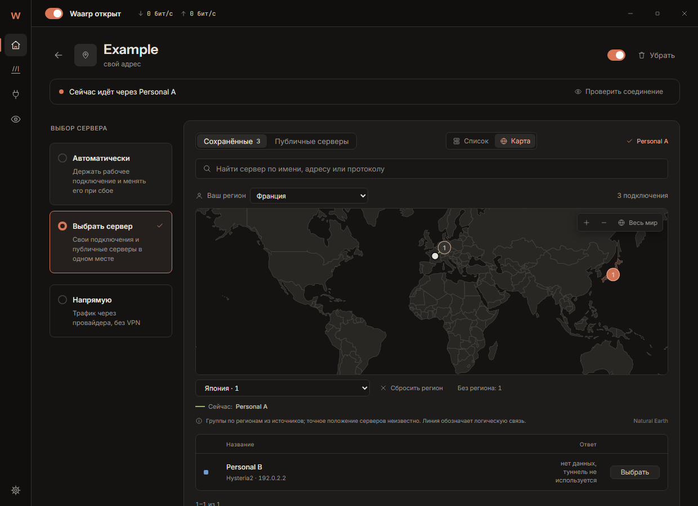
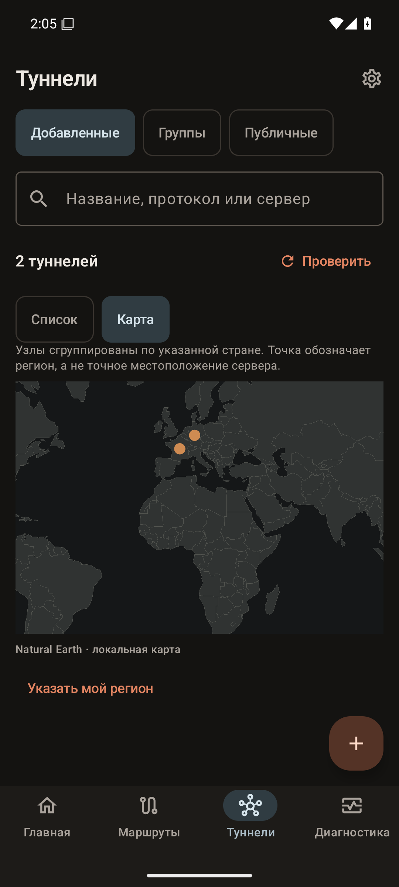
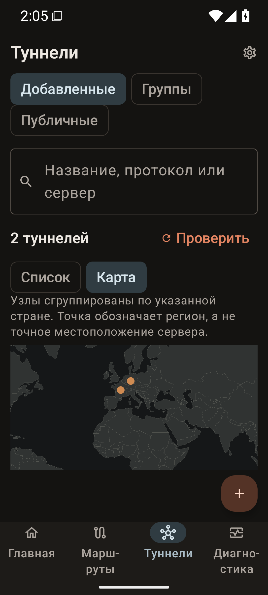

# Preview r5 — реальные кадры Windows и Android

Источник всех изображений: [`928c9a8e3cd0a83a41ebfa15c2628ddb610ea157`](https://github.com/INNVoices/waarp/commit/928c9a8e3cd0a83a41ebfa15c2628ddb610ea157), **Windows 0.4.1-rc.4 · Android 0.5.0-rc.5**. [Выпуск r5](https://github.com/INNVoices/waarp/releases/tag/preview-2026-11-18-r5) опубликован после успешного [preview workflow 44316534164](https://github.com/INNVoices/waarp/actions/runs/44316534164). PNG скопированы из журналов без перерисовки, монтажа или изменения размеров.

## Windows

Настоящий собранный renderer, MapLibre WebGL и локальный worker. Профили, текущий путь и время ответа задаются синтетическим IPC fixture. Это проверка интерфейса; доступность внешних серверов по этим кадрам не устанавливается. Все четыре изображения просмотрены.

| Кадр | Что проверено визуально |
| --- | --- |
| [Карта, 1240 px](windows-atlas-picker-1240.png) | Франция как регион пользователя, актуальная подсветка Японии и сохранение текущего Personal A при просмотре Personal B |
| [Карта, 900 px](windows-atlas-picker-900.png) | Перестроенная узкая компоновка, прежний поиск, фильтры и явная кнопка выбора |
| [Диагностика, 1240 px](windows-quality-1240.png) | Длинные названия и кнопка действия помещаются; «ответов 2 из 2» сохраняется в одной строке |
| [Диагностика, 900 px](windows-quality-900.png) | Основное действие и видимые блоки не перекрыты; нижняя часть результата доступна обычной прокруткой |

[Точный источник, размеры и SHA-256](windows-provenance.json). Windows job 134844904516 завершился SUCCESS. Отдельный общий CI того же SHA имел отказ бюджета 90 s; он раскрыт в [приёмке](../../planning/WAARP-NEXT-2026-11-18/09-ACCEPTANCE.md) и не скрывается этой галереей.

## Android

Настоящее приложение Compose/MapLibre, Android 15 / API 35 / x86_64 emulator. Все четыре gallery-сценария прошли. Проверены доступность действий, отсутствие перекрытия навигационных подписей, сохранение ручного региона после «Список → Карта», неизменность VPN OFF/revision при просмотре и последующее единственное сохранение маршрута. Профили и адреса синтетические.

Оба кадра просмотрены. При 150% подписи переносятся по словам с дефисом: «Марш-/руты», «Диагно-/стика»; одиночной «ы», обрезания и наложения нет. Размер шрифта не уменьшен. Кнопка проверки и плавающая кнопка добавления разделены; длинное содержимое сохраняет прокрутку.

  
  

Обычный шрифт · Увеличение до 150%

[Точный источник, среда, размеры и SHA-256](android-provenance.json). Android job 134844904814 завершился SUCCESS. Полная матрица accessibility и физических устройств остаётся отдельной границей, указанной в [итоговой приёмке](../../planning/WAARP-NEXT-2026-11-18/09-ACCEPTANCE.md).
