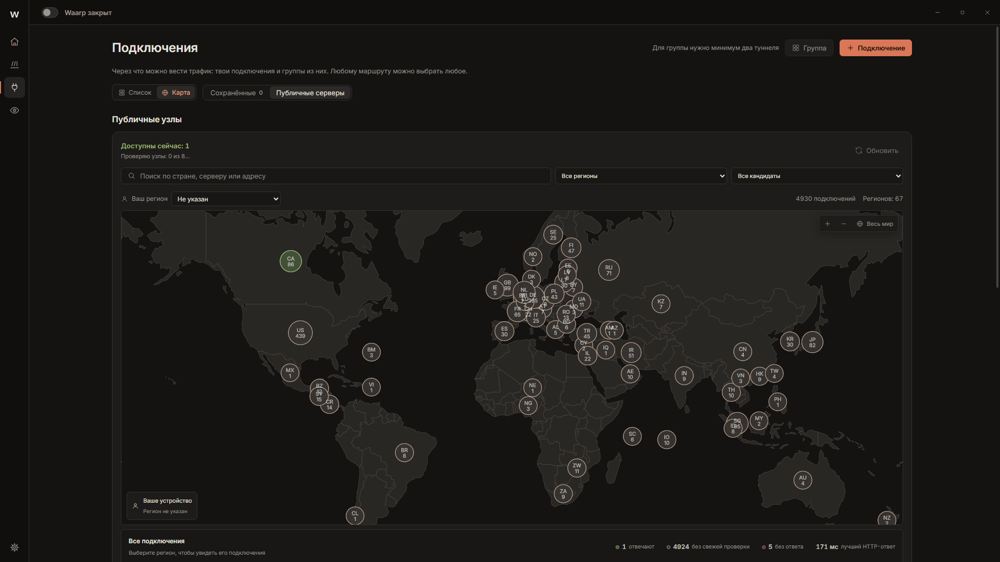
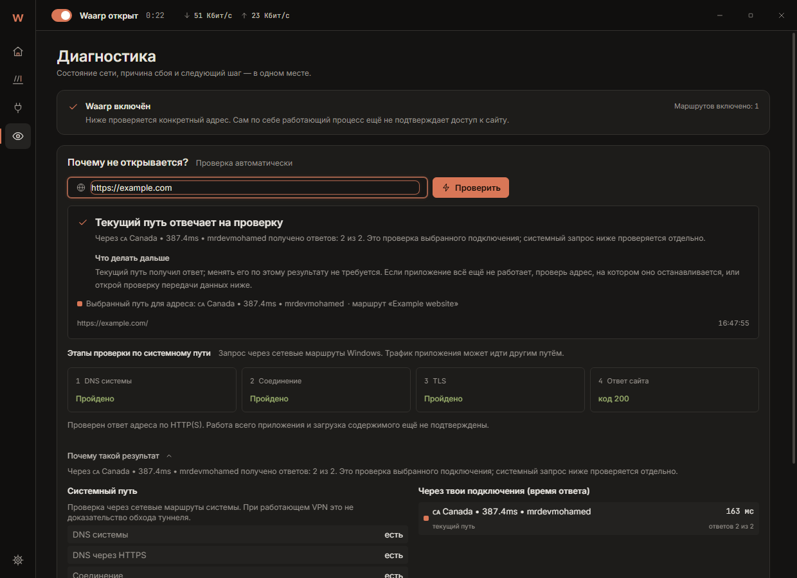

# Preview r6 — Windows EXE и настоящие публичные источники

**Windows 0.4.1-rc.5**, исходный коммит [`0e0bb6c7cad421dc0fff377d8c7f826d115e0292`](https://github.com/INNVoices/waarp/commit/0e0bb6c7cad421dc0fff377d8c7f826d115e0292). [Выпуск r6 опубликован](https://github.com/INNVoices/waarp/releases/tag/preview-2026-11-18-r6) после успешного [preview workflow 44348809024](https://github.com/INNVoices/waarp/actions/runs/44348809024), Windows job **134959333754**. Android в этой галерее и выпуске ПК не обновлялся.

PNG сняты с настоящего упакованного Windows EXE в GitHub-hosted Windows runner и скопированы без перерисовки, монтажа или изменения размеров. Использованы настоящий IPC, pinned native core и полученные в ходе запуска публичные списки; подставленных серверов и ответов нет. Страны происходят из метаданных или названий источников. Регион пользователя задаётся вручную; в этих кадрах он не задан. Геолокация по IP не выполнялась.

## Кадры приложения

| Кадр | Состояние и назначение |
| --- | --- |
| [Публичная карта, 1920×1080](desktop-public-real-1920.png) | Первый подтверждённый ответ найден автоматически до сохранения серверов; карта **1502×605 px** |
| [Публичная карта, 1240×900](desktop-public-real-1240.png) | Та же рабочая область в меньшем окне; карта **1076×504 px**, горизонтального переполнения нет |
| [Публичные узлы при ON, 1920×1080](desktop-public-on-1920.png) | Проверка продолжается при работающем VPN; сохранены сессия и выбранный маршрут |
| [Сохранённое подключение, 1920×1080](desktop-saved-real-1920.png) | Сервер сохранён видимой кнопкой, страна перенесена; карта **1536×605 px** |
| [Диагностика, 1240×900](desktop-diagnostics-real-1240.png) | Автоматическое расследование существующего маршрута, четыре этапа, ответ текущего пути и следующий шаг |

## Измеренные результаты

[Отчёт настоящего EXE](public-catalog-windows.json): **4930 кандидатов**, первый доступный узел через **102 737 ms**, **0 сохранённых профилей** до нажатия «Добавить». К этому моменту выполнено 6 проверок: 1 ответ, 5 без ответа; ещё 2 узла пропущены на подготовке. Выбран **VLESS · REALITY**, регион источника **CA**, измеренный HTTP-ответ **171 ms**.

При ON выполнено ещё **8 проверок**, всего 14; ответили 4 узла. Сессия, маршрут и число сохранённых профилей сохранены. При переходе к сохранённым подключениям автоматическая аренда снята. Диагностика `https://example.com` распознала существующий маршрут, получила **2 ответа из 2** через текущий путь и сохранила его. Необработанных ошибок renderer нет. Иконка **256×256** успешно прочитана из пакета.

[Проверка пакета](package-integrity-windows.json): `windowIconPresent`, runtime и pinned engine — PASS. SHA-256 опубликованного portable EXE: `3cdd81a22ddb48d655714351a2ed581b608b680140f51c8b657fb994a6bf1317`.

Эти результаты описывают сеть и время прогона. Доступность стороннего сервера у другого провайдера, игровое качество и точное географическое положение по кадрам не устанавливаются. Числа в названиях исходных серверов могут быть метками источника; свежие измерения показаны в отдельном поле ответа и JSON-отчёте.

## Отдельный отказ general CI того же SHA

В preview native TUN lifecycle прошёл **50/50**, **381 571 ms / 600 000 ms**. В независимом [general CI 44348808981](https://github.com/INNVoices/waarp/actions/runs/44348808981), Windows job **134958446897**, тот же сценарий завершился **FAIL после 19/50**, `owned_child_exit_timeout`, **143 224 ms / 600 000 ms**; упаковка в этом general job была пропущена. Причина расхождения и окончательное состояние очистки из доступного лога не установлены.

[Сводка general CI](general-ci-windows.json) · [точный native failure](native-failure-excerpt.log) · [полная запись исправлений и границ приёмки](../../DESKTOP-FIXES-2026-11-18.md). Квота загрузки артефактов и полный audit инструментов сборки также оставили ошибки общего CI; успешная галерея и preview не заменяют эти результаты.
